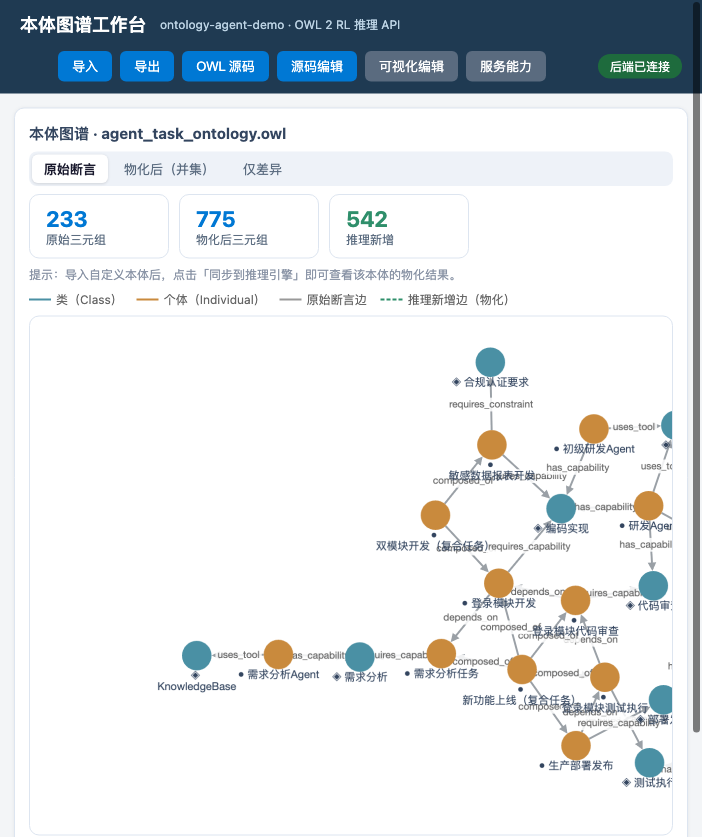

# 本体 × 智能体协作 Demo

[](https://github.com/jasony62/ontology-agent-demo/actions/workflows/ci.yml)
[](LICENSE)
[](pyproject.toml)
[](docs/guide/README.md)

演示**本体（Ontology）如何与智能体（Agent）配合**：用户用自然语言提问，智能体负责理解与编排（把问题翻译成对推理 API 的调用），本体负责给出确定性、可解释的推理结论，智能体再把结论组织成回答。全程可视化展示「事实 → 规则 → 结论」的推导链。

一句话定位：**把本体推理能力打包成一个开箱即用的工具**——一条命令起服务，MCP 接入智能体，配套 9 篇《本体上手指南》边学边跑。



## 演示场景

| # | 问法               | 智能体做什么 | 本体推理做什么         |
| - | ---------------- | ------ | --------------- |
| 1 | 「登录模块开发谁能做？」     | 识别任务实体 | R1 能力匹配（属性链）    |
| 2 | 「新功能上线怎么安排？」     | 拆解任务链  | R3 依赖传递 + 逐环节匹配 |
| 3 | 「把合规报表开发分配给初级研发」 | 执行分配   | R4 合规冲突检测       |
| 4 | 「为什么选研发 Agent？」  | 追问上一步  | 返回推导链（事实→规则→结论） |
| 5 | 「检查一下有没有冲突」      | 触发检查   | 一致性检查           |
| 6 | 「介绍一下这个本体」       | 读取本体概览 | 结构导出            |

## 快速开始

**要求**：Python 3.10+（推荐 3.10–3.12，实测 3.14 亦可）、Git。

### 方式一：一键脚本（推荐，macOS / Linux）

```bash
cd ontology-agent-demo
bash scripts/start.sh        # 建 venv → 装依赖 → 起服务 → 自动打开浏览器
```

### 方式二：Docker

```bash
cd ontology-agent-demo
docker compose up            # 同时起 API(:8000) 和 MCP(:9000)
```

> Dockerfile 默认用国内 pip 源（清华 TUNA）加速依赖安装；如需官方源：`docker build --build-arg PIP_INDEX_URL=https://pypi.org/simple -t ontology-agent-demo .`

### 方式三：手动

```bash
cd ontology-agent-demo

# 1. 创建虚拟环境并安装依赖（首次）
python3 -m venv .venv
.venv/bin/pip install -r requirements.txt

# 2. 构建本体（可选，仓库已内置 domains/agent_task/agent_task_ontology.owl）
.venv/bin/python scripts/build_ontology.py

# 3. 启动推理 API + Demo 页面
.venv/bin/uvicorn api.main:app --host 127.0.0.1 --port 8000
```

打开浏览器访问 [http://127.0.0.1:8000](http://127.0.0.1:8000) 即可。

### 运行测试与一键演示

```bash
.venv/bin/python -m pytest tests/ -v      # 29 项测试
make demo                                  # 按顺序跑一遍核心接口（需服务已启动）
```

> `make` 命令清单：`make setup` / `make run` / `make mcp` / `make test` / `make demo` / `make build-ontology` / `make docs`。

## 前端应用（本体图谱工作台）

`frontend/app/` 是基于 [Microsoft Ontology-Playground](https://github.com/microsoft/Ontology-Playground)（MIT）代码实现的功能完整前端：

- **图谱工作台**：Cytoscape.js 交互图谱，三种视图——原始断言 / 物化后（并集）/ 仅差异；推理新增边以虚线+独立色标注
- **OWL 源码**：RDF/XML 源码语法高亮查看，支持源码编辑（保存时解析校验回读）
- **导入 / 导出**：拖拽上传 `.owl`/`.rdf` 解析展示；导出当前模型（RDF/XML）或物化后本体（Turtle / RDF/XML）
- **可视化编辑**：实体 / 属性 / 关系 CRUD + 实时校验，改动即时反映到图谱
- **物化展示**：调用推理引擎物化 diff（原始断言 ∪ 推理新增），统计卡片显示三元组数量变化

```bash
# 开发（先启动后端 :8000）
cd frontend/app
npm install
npm run dev                 # http://localhost:5173（/api 自动代理到 :8000）

# 生产构建（构建后由 FastAPI 托管，GET / 优先返回新前端）
npm run build               # 产物 frontend/app/dist
```

> 说明：导入自定义本体后点击「同步到推理引擎」进入通用模式——图谱 / 物化 / SPARQL 等通用能力可用，领域推理（R1–R4）仅默认本体可用（接口返回明确提示）。

## 架构

```
浏览器前端（图谱展示）              智能体（豆包等，经 MCP 接入）
        │                                │
        │ ① /api/ontology 图谱数据       │ ① MCP 工具调用（能力匹配/编排/分配…）
        ▼                                ▼
推理 API（api/main.py · FastAPI）◄─────── MCP Server（mcp/mcp_server.py · :9000）
   /api/ontology /api/reason /api/classify /api/explain /api/consistency
        │ ② 触发推理（领域适配器）
        ▼
通用引擎（reasoner/engine.py）
  L1 OWL 2 RL（owlrl）：R1 属性链、R3 传递闭包
  L2 领域适配器（domains/agent_task）：R2 复合任务委派、R4 合规冲突
  L3 查询服务 + 推导链
        │ ③ 加载并推理
        ▼
本体模型（domains/agent_task/agent_task_ontology.owl · OWL 2）
  类层次 / 属性约束 / 推理公理 / 演示个体
```

> 推理器说明：HermiT（owlready2 内置）需要 Java Runtime。本 Demo 为保证 **零依赖随处可跑**，推理层改用纯 Python 的 OWL 2 RL（owlrl）+ 业务规则引擎；本体仍为标准 OWL 2 文件，可在 Protege（配 Java）中直接打开并跑 HermiT 校验。

## 推理 API

| 方法   | 路径                 | 功能                                                           |
| ---- | ------------------ | ------------------------------------------------------------ |
| GET  | `/`                | Demo 页面（图谱展示）                                             |
| GET  | `/api/health`      | 健康检查                                                         |
| GET  | `/api/ontology`    | 本体结构（图谱渲染数据）                                                 |
| POST | `/api/reason`      | `{type: capability_match\|orchestrate\|assign, task, agent}` |
| POST | `/api/classify`    | 新增任务个体并自动分类                                                  |
| POST | `/api/explain`     | 最近一次推理的推导链                                                   |
| POST | `/api/consistency` | 一致性 / 合规冲突检查                                                 |

通用查询接口（v1.1.0 起，**与本体定义无关**，任意 `.owl` 加载后均可使用）：

| 方法   | 路径                 | 功能                                                           |
| ---- | ------------------ | ------------------------------------------------------------ |
| POST | `/api/query`       | 执行 SPARQL SELECT `{sparql}`，结果 IRI 自动转短名                     |
| POST | `/api/individuals` | 指定类（含子类）的个体列表 `{class_name}`                                |
| POST | `/api/classes`     | 全部类层次（name/label/parent）                                    |
| POST | `/api/types`       | 个体推理后的全部类型 `{individual}`                                   |
| POST | `/api/property`    | 主体-属性取值列表 `{subject, property}`                              |
| POST | `/api/infer`       | 重新执行推理，返回三元组/个体统计                                          |

示例：

```
curl -s -X POST http://127.0.0.1:8000/api/reason \
  -H "Content-Type: application/json" \
  -d '{"type":"capability_match","task":"t_login_dev"}'

curl -s -X POST http://127.0.0.1:8000/api/query \
  -H "Content-Type: application/json" \
  -d '{"sparql":"SELECT ?i WHERE { ?i a <http://demo.example.org/agent-task-ontology#Agent> }"}'

curl -s -X POST http://127.0.0.1:8000/api/individuals \
  -H "Content-Type: application/json" \
  -d '{"class_name":"Task"}'
```

## 架构：通用引擎 + 领域适配器（运行时动态加载）

核心代码与本体定义**完全解耦**：

- **通用引擎** `reasoner/engine.py`：加载任意 `.owl`、OWL 2 RL 推理、SPARQL / 个体 / 类 / 类型 / 属性 / 重推理，
  不含任何领域词汇（没有 `Agent` / `Task` / `can_execute` 等）；
- **领域适配器** `domains/`：领域语义（能力匹配 / 编排 / 分配合规 / 分类 / 图谱）**全部外置**，
  通过 `domains/registry.py` 的约定式注册表在运行时动态加载
  （`domains/__init__.py` 只做导出）；领域包内业务逻辑在 `domains/agent_task/adapter.py`，
  `domains/agent_task/__init__.py` 只做导出：

```python
from reasoner.engine import get_engine
from domains import list_domains, load_domain

list_domains()                      # 枚举可用领域：[{"name","description","module"}, ...]
adapter = load_domain("agent_task", get_engine())   # 按名加载适配器
adapter.capability_match(adapter.NS["t_login_dev"]) # 领域查询
get_engine().individuals("Task")    # 通用查询（任意本体可用）
```

当前默认领域 `domains/agent_task/`：领域数据按关注点分两个独立 JSON——
`config.json`（类角色映射）、`derivation.json`（推导链文案模板 + 展开规则），
查询服务在 `adapter.py`（R2/R4 规则），**MCP 领域工具注册在 `mcp.py`**（8 个领域工具随领域包走）。
**中文名标签统一来自本体 rdfs:label**（引擎 `label()` 读取，支持 URIRef 与短名），
不再在配置中重复维护——owl 是中文名的唯一事实源。
**属性名采用"语义名即本体短名"约定**：属性与本体同名时无需配置（`SemanticConfig.resolve()` 兜底），
换本体（属性名不同）时在 config.json 覆盖即可。
**语义配置与推导链展开均为引擎配套的通用机制**（`reasoner/semantic.py` 配置容器+JSON 加载、
`reasoner/derivation.py` 声明式推导链解释器，均不含领域词汇），领域包只提供数据。
**领域数据可编辑**：改 `domains/agent_task/config.json` 即改领域语义与推导链叙事，无需动 Python。
换领域 = 在 `domains/` 下新增一个包（暴露 `NAME / DESCRIPTION / create_adapter`），
核心引擎、API、MCP、CLI 无需改动。

```python
# 换同构本体语义：基于默认配置整体覆盖（返回新配置，原配置不可变）
from domains.agent_task import AgentTaskAdapter, DEFAULT_CONFIG
adapter = AgentTaskAdapter(get_engine(), DEFAULT_CONFIG.update(
    agent_class="Worker", task_class="Job", complex_task_class="Pipeline",
    has_capability="owns_skill", requires_capability="needs_skill"))
```

## 推理规则

| 规则        | 内容                                                | 实现层              |
| --------- | ------------------------------------------------- | ---------------- |
| R1 能力匹配   | `has_capability ◦ required_by ⊑ can_execute`（属性链） | owlrl / OWL 2 RL |
| R2 复合任务委派 | Agent 可执行复合任务的全部子任务 ⇒ 可执行复合任务                     | 业务规则             |
| R3 依赖传递   | `depends_on` 传递闭包                                 | owlrl / OWL 2 RL |
| R4 合规冲突   | 任务要求合规认证、Agent 未认证 ⇒ 冲突报告                         | 业务规则             |

## 目录结构

```
ontology-agent-demo/
├── reasoner/
│   ├── engine.py                      # 通用引擎（加载/推理/SPARQL/通用查询，与本体无关）
│   ├── semantic.py                    # 通用语义配置（不可变键值容器 + JSON 加载器，零领域词汇）
│   └── derivation.py                  # 通用推导链解释器（声明式步骤规则展开，零领域词汇）
├── domains/                           # 领域适配器（独立目录，运行时动态加载）
│   ├── __init__.py                    # list_domains / load_domain 注册表
│   └── agent_task/                    # 「智能体任务编排」领域（自包含）
│       ├── agent_task_ontology.owl    # 本体定义（Protege 可打开）
│       ├── __init__.py                # 纯导出（NAME/DESCRIPTION/ONTO_FILE/适配器符号）
│       ├── adapter.py                 # 领域适配器（R2/R4 规则 + 5 个查询方法 + 图谱导出）
│       ├── config.json                # 领域语义配置（类角色映射/结构数据；中文名见 owl rdfs:label，属性名默认同本体短名）
│       ├── derivation.json            # 领域推导链配置（文案模板 templates + 展开规则 derivations）
│       └── mcp.py                     # 领域 MCP 工具注册（8 个领域工具，register_tools）
├── api/
│   ├── main.py                        # FastAPI（领域端点走适配器 + 通用端点走引擎）
│   └── schemas.py                     # 请求模型
├── mcp/mcp_server.py                  # MCP Server 通用出口（--domain 动态加载领域工具 + 6 个通用工具）
├── frontend/index.html                # 图谱可视化展示页
├── scripts/
│   ├── build_ontology.py              # 一键重建本体（含结构自检）
│   ├── start.sh                       # 一键启动（venv → 依赖 → 服务 → 浏览器）
│   └── demo.sh                        # 一键演示（curl 串演核心接口）
├── docs/
│   └── guide/                         # 《本体上手指南》9 篇（MkDocs 构建在线站点）
├── assets/demo.png                    # README 演示截图
├── tests/                             # 推理 + API 自动化测试（29 项）
├── .github/workflows/                 # CI（pytest × 3.10-3.12）+ GitHub Pages
├── Makefile / docker-compose.yml / Dockerfile / pyproject.toml
└── README.md
```

## MCP 接入（智能体直接调用）

本体推理已封装为标准 MCP Server（`mcp/mcp_server.py`，内嵌引擎、复用项目本体），
**通用出口层**：8 个领域工具随领域包走（`domains/agent_task/mcp.py` 注册，
能力匹配/编排/分配/分类/一致性/推导链/图谱/实体）+ 6 个通用工具（SPARQL/个体/类/类型/属性/重推理）。

```bash
cd ontology-agent-demo
.venv/bin/python mcp/mcp_server.py --domain agent_task --port 9000   # 默认 agent_task；streamable-http
.venv/bin/python mcp/mcp_server.py --transport stdio                 # stdio（本地 Client）
```

接入豆包：侧边栏「技能 / 连接器」→ 添加 → 新建自定义连接器 → 传输类型 **HTTP** →
URL 填 `http://127.0.0.1:9000/mcp`，保存后即可在对话中直接调用。

## 与《本体上手指南》配套

仓库内 `docs/guide/` 是面向**零本体基础**读者的 9 篇入门系列，每篇都有可复现的命令，
并在 [指南首页](docs/guide/README.md) 提供**章节 ↔ 仓库代码对照表**（讲哪段，去哪个文件看）。
学习路径：

```
概念认知            推理与图谱            服务搭建            应用与扩展
┌─────────────┐   ┌─────────────┐   ┌─────────────┐   ┌─────────────┐
│ 00 为什么需要本体 │ → │ 03 推理原理    │ → │ 05 推理服务   │ → │ 07 协作实战   │
│ 01 本体入门     │   │ 04 与知识图谱  │   │ 06 MCP接入   │   │ 08 扩展新领域 │
│ 02 解剖示例本体 │   └─────────────┘   └─────────────┘   └─────────────┘
└─────────────┘
```

- 本地看：直接打开 `docs/guide/README.md`
- 在线看：GitHub Pages 自动构建（仓库 Settings → Pages → Source 选 **GitHub Actions**）

## 开发与贡献

- **测试**：`make test`（pytest，29 项，含推理规则与 API 闭环）；CI 在 push / PR 时对 Python 3.10–3.12 全量跑。
- **文档**：指南用 MkDocs 构建，推送 `main` 后由 CI 自动构建并部署 GitHub Pages；本地 `make docs` 预览需 Python 3.10–3.12（当前机器 3.14 暂无 watchdog 轮子，故本地构建在 CI 上验证）。
- **可安装包**：`pip install -e .`（pyproject.toml，依赖与 requirements.txt 一致）。
- 欢迎提 Issue / PR；新增领域见指南篇 8。

## 备注

* 智能体由**外部 AI 智能体**（如豆包）经 MCP 连接器承担：对话 / 理解由智能体负责，本体推理由本服务负责（确定性、可解释）。

* 通过 API / MCP 执行「分配」会修改引擎内存中的分配记录并实时反映到图谱（assigned\_to 边）。

* 许可证：MIT。
