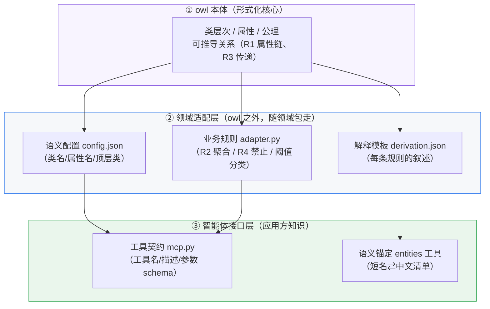

# owl 之外的知识：本体不能单独承载业务知识

> 本文围绕本项目演示中的一个重要发现展开：**仅凭 OWL 本体定义，无法完整承载
> 一个真实业务场景所需的全部知识**。梳理 owl 覆盖的知识范围、真实应用中的知识缺口，
> 以及智能体使用场景下必须额外补充的知识，并给出项目中的真实示例。
>
> 配套：`DESIGN.md`（架构设计）、`FLOW.md`（自然语言→推理全链路）、`REASONING.md`（推理原理）。

---

## 1. 核心发现

本项目「智能体任务编排」演示中，核心业务规则共 4 条，最终只有 2 条能由 owl 表达：

| 规则 | 内容 | 能否进 owl | 载体 |
|---|---|---|---|
| R1 能力匹配 | 有能力的 Agent 可执行需要该能力的任务 | ✅ 能（属性链） | owl：`can_execute` 属性链 |
| R3 依赖传递 | 依赖关系可传递 | ✅ 能（传递属性） | owl：`depends_on` |
| R2 复合任务委派 | 可执行全部子任务 ⇒ 可执行复合任务 | ❌ 不能（聚合） | 代码：adapter.py |
| R4 合规约束 | 合规任务禁止分配给未认证 Agent | ❌ 不能（禁止性） | 代码：adapter.py |

加上智能体要**使用**本体服务所需的接口契约、语义锚定、解释模板等知识，
owl 之外的知识量在真实项目中往往**大于** owl 本身。这不是 owl 的缺陷，
而是知识形态的分工：owl 负责"形式化、可推导"的核心，其余知识需要显式补充。

---

## 2. owl 覆盖的知识范围

### 2.1 知识形态：TBox + ABox

| 层 | 知识类型 | 项目示例 |
|---|---|---|
| TBox（模式） | 类层次、属性、公理 | 25 个类、12 个属性、4 条公理 |
| ABox（数据） | 个体断言 | 13 个个体（Agent / Task）及其属性、数据值 |

### 2.2 owl 能表达的 6 类知识

| # | 知识类型 | owl 机制 | 项目示例 |
|---|---|---|---|
| 1 | 分类与层次 | `subClassOf` | `DevAgent ⊑ Agent`；`SimpleTask ⊑ Task` |
| 2 | 属性与方向 | `ObjectProperty` + `domain`/`range`/`inverseOf` | `required_by` 是 `requires_capability` 的逆 |
| 3 | 可推导的二元关系 | `propertyChainAxiom`（属性链） | `can_execute ⊑ has_capability ◦ required_by` |
| 4 | 传递闭包 | `TransitiveProperty` | `depends_on` 传递 |
| 5 | 定义类（分类规则） | `equivalentClass` + 约束 | `CertifiedAgent`（值约束）；`ComplianceTask`（存在量词） |
| 6 | 个体事实 | `NamedIndividual` 断言 | `dev_agent has_capability Coding` |

### 2.3 owl 知识的特点（边界）

- **擅长**：静态分类、二元关系、可单步/链式推导的结论；
- **表达单位**：一条条"类-属性-关系"三元组公理；
- **推理方式**：前向规则（owlrl）物化隐含事实；
- **本质局限**：owl 表达"**是什么 / 可推什么**"，不表达"**怎么做 / 禁止什么 / 怎么解释**"。

---

## 3. 真实业务场景还需要哪些知识

### 3.1 逻辑形态缺口（owl 表达不了的四种逻辑）

| 缺口 | 业务例子 | owl 为什么不能表达 |
|---|---|---|
| **聚合逻辑** | R2：Agent 可执行复合任务的全部子任务 ⇒ 可执行该任务 | 属性链只能表达单路径 `x P z ∧ y Q z`，无法表达"遍历子任务集合、全部满足" |
| **禁止性规则** | R4：合规任务禁止分配给未认证 Agent | owl 公理推导"是什么"；"禁止什么"是运行时检查，不是可推结论 |
| **数值/阈值判断** | 风险等级 ≥ 5 ⇒ 高风险任务 | OWL RL 不支持算术比较（`has_risk_level` 是整数数据，比较逻辑在代码里） |
| **流程与顺序** | 编排：按 `depends_on` 拓扑排序后依次执行 | owl 只有静态关系，没有"先后次序 / 执行步"概念 |

### 3.2 工程可用性缺口（owl 给不了但使用它必须的）

| 缺口 | 说明 | 项目补充方式 |
|---|---|---|
| 自然语言标签 | owl 有 `rdfs:label`，但类/属性/个体分布散、口径不一 | 实体清单 entities 工具统一输出短名⇄中文 |
| 查询策略 | 用户问题怎么变成查询？该查什么 | 领域适配器 5 个查询方法 + MCP 工具封装 |
| 解释知识 | 结果"为什么"这样（推导路径） | `derivation.json` 声明式叙述模板 |
| 展示知识 | 图谱怎么分组、隐藏哪些定义类 | config.json（top_classes / hidden_label_classes） |
| 领域配置 | 类名/属性名/顶层类是哪些 | config.json（semantic 段） |
| 版本与变更 | 本体演进、规则归属谁管 | DESIGN.md 第 6 章（规则归属约定） |

### 3.3 知识分层总览



**owl 只占 L1；L2 是 owl 表达不了的业务知识；L3 是"给智能体用"必须补的接口知识。**

---

## 4. 面对智能体使用需求：必须补充的知识

智能体不是"直接读 owl"，而是**通过 MCP 工具调用本体服务**。要让智能体能正确选工具、
识别实体、调用并解释结果，必须补充三类 owl 完全没有的知识。

### 4.1 工具契约知识（怎么调用）——MCP 工具定义

每个工具 = **工具名 + description（业务语义 + 示例短名）+ 参数 schema**。
owl 里有 `has_capability` 属性，但**没有任何信息告诉智能体"有个工具叫 capability_match、
参数 task 要传个体短名"**。

项目真实示例（`domains/agent_task/mcp.py`）：

```python
@server.tool(description="能力匹配（R1/R2）：查询哪些智能体可执行指定任务，返回匹配列表与推导链。"
                         "task 为本体个体短名，如 t_login_dev、t_compliance_dev、t_double_dev。")
def capability_match(task: str) -> dict:
    return adapter.capability_match(adapter.NS[task])

@server.tool(description="新增任务个体并自动分类：按所需能力与约束创建任务，重新推理后返回"
                         "推理出的类型（合规任务/高风险任务）与可执行智能体。"
                         "capabilities 如 ['Coding']，constraints 如 ['ComplianceRequirement']。")
def classify(name: str, capabilities: list[str], constraints: list[str], risk_level: int = 3) -> dict:
    return adapter.classify(name, capabilities, constraints, risk_level)
```

| 工具契约要素 | 智能体的用途 | owl 能否提供 |
|---|---|---|
| 工具名 | 匹配用户意图（"谁能做登录模块开发" → capability_match） | ❌ |
| description 业务语义 + 示例短名 | 判断该不该调、参数怎么填 | ❌（label 有，但"参数取值示例"没有） |
| 参数 schema（类型/默认值） | 校验并生成调用参数 | ❌ |

### 4.2 语义锚定知识（怎么把自然语言对应到本体元素）

智能体识别出实体后，需要知道"**有哪些候选个体、短名是什么、中文名是什么**"。
owl 的 `rdfs:label` 提供中文名，但**分散在各处、没有按角色汇总**；短名（local name）
更是只有加载后才知道。

项目真实示例（`entities` 工具返回，mcp.py）：

```json
{
  "tasks":  [{"name": "t_login_dev",  "label": "登录模块开发"}],
  "agents": [{"name": "dev_agent",    "label": "研发Agent"}],
  "capabilities": ["Coding", "CodeReview", "Testing"],
  "constraints":  ["ComplianceRequirement", "SecurityRequirement"]
}
```

| 语义锚定知识 | 智能体的用途 | owl 能否直接提供 |
|---|---|---|
| 实体候选清单（按任务/智能体/能力/约束分组） | 识别实体时给出候选，避免瞎猜 | ❌（个体分散，无"按角色汇总"视图） |
| 短名 ⇄ 中文标签映射 | 参数传短名、回显中文 | ⚠️ 部分（owl 有 label，需自行汇总） |
| 类型归属（参数槽位决定填个体还是类） | 填参：task/agent 填个体，capabilities 填类 | ❌（属于工具参数定义） |

### 4.3 解释知识（怎么回答"为什么"）

owlrl 推理**只物化结果、不记录推导路径**。智能体回答"为什么这个 Agent 能执行该任务"时，
需要一套叙述模板把推理链重讲一遍——这在 owl 里完全没有。

项目真实示例（`derivation.json`）：

```json
{
  "templates": {
    "rule_r1": "规则 R1（OWL 属性链）：has_capability ◦ required_by ⊑ can_execute",
    "fact_agent_has_cap": "Agent「{agent}」具备能力「{cap}」（has_capability）",
    "conclusion_can_execute": "结论：{agent} 可执行「{task}」"
  },
  "derivations": {
    "capability_match": [
      { "if": "$matches", "then": [ { "loop": "$matches", "var": "m", "steps": [...] } ] }
    ]
  }
}
```

推导出的中文解释：

```
Agent「研发Agent」具备能力「编码实现」（has_capability）
任务「登录模块开发」需要能力「编码实现」（requires_capability）
规则 R1（OWL 属性链）：has_capability ◦ required_by ⊑ can_execute
结论：研发Agent 可执行「登录模块开发」
```

| 解释知识 | 智能体的用途 | owl 能否提供 |
|---|---|---|
| 规则叙述（每条规则怎么说） | 推导链中的"规则行" | ❌（公理是 XML，不是人话） |
| 事实叙述（每个断言怎么说） | 推导链中的"前提行" | ❌ |
| 结论叙述 | 推导链的落点 | ❌ |
| 组装逻辑（if/loop/step） | 按查询类型组织推导链 | ❌ |

### 4.4 业务规则知识（阈值与判定）

聚合（R2）、禁止（R4）、数值分类（风险 ≥ 5）这些 owl 表达不了的规则，
作为代码随领域包提供，是智能体调用时"隐含的业务知识"：

```python
# adapter.py（节选）
if self.c.compliance_constraint_class in cons:      # 存在合规约束 ⇒ 合规任务
    inferred_types.append({"class": "ComplianceTask", ...})
if risk_level >= 5:                                 # 风险等级阈值 ⇒ 高风险任务
    inferred_types.append({"class": "HighRiskTask", ...})
```

### 4.5 智能体使用场景知识总表

| 知识 | 智能体用它做什么 | 载体 | owl 能否提供 |
|---|---|---|---|
| 工具契约（名/描述/参数） | 选工具、生成调用 | mcp.py | ❌ |
| 实体候选清单 | 识别实体、填参 | entities 工具 + owl 个体 | ⚠️ 需汇总 |
| 短名⇄中文映射 | 传参/回显 | owl label + entities | ⚠️ 需汇总 |
| 推导链叙述模板 | 回答"为什么" | derivation.json | ❌ |
| 业务规则/阈值 | 隐含判定逻辑 | adapter.py | ❌ |
| 领域配置（类名/顶层类） | 换本体时复用领域查询 | config.json | ❌（这是"关于本体的知识"） |

### 4.6 智能体调用链路（三种知识如何协同）


---

## 5. 项目中的落地映射：每种知识放哪

| 知识类型 | 载体文件 | owl 之外？ |
|---|---|---|
| 分类/关系/可推导公理 | 本体 OWL 文件 | 否（owl 本身） |
| 语义配置（类名/属性名/顶层类/隐藏类） | `domains/<领域>/config.json` | 是 |
| 解释模板与推导链组装 | `domains/<领域>/derivation.json` | 是 |
| 业务规则（R2/R4/分类阈值） | `domains/<领域>/adapter.py` | 是 |
| 工具契约（工具名/描述/参数） | `domains/<领域>/mcp.py` | 是 |
| 实体清单（短名⇄中文） | `entities()` 工具（读取 owl 个体 + label） | 部分（源自 owl，但"汇总视图"是补充的） |
| 通用接口（SPARQL/图谱/类查询） | `reasoner/engine.py` + 通用 MCP 工具 | 否（与本体无关的 L1 通用层） |

---

## 6. 给新领域部署的 checklist（部署本体时必须准备哪些 owl 之外的知识）

用本项目「智能体任务编排」演示验证过的清单，部署任何新本体时逐项补齐：

- [ ] **语义配置**：类名/属性名/顶层类/隐藏类 → `config.json`
- [ ] **解释模板**：每条规则一句人话 + 事实/结论叙述 + 组装逻辑 → `derivation.json`
- [ ] **业务规则**：owl 表达不了的聚合/禁止/阈值逻辑 → `adapter.py`
- [ ] **工具契约**：每个工具的 description（含示例短名）+ 参数 schema → `mcp.py`
- [ ] **实体可查询**：所有个体都有中文 label（否则 entities 回显空白）
- [ ] **问法-工具示例**：常见自然语言问法对应的工具调用（放入工具描述或 skill 文档）
- [ ] **规则归属确认**：每条业务规则明确属于 owl（公理）还是代码（适配器），避免两边各写一半

---

## 7. 结论

1. **owl 覆盖的知识 = 形式化分类 + 可推导的二元关系**：适合表达"有什么、怎么推"；
2. **真实业务缺口 = 聚合 / 禁止 / 数值 / 流程四类逻辑 + 标签 / 解释 / 展示 / 配置等工程知识**：
   这些 owl 表达不了或维护成本过高，必须显式补充；
3. **智能体使用场景额外需要 = 工具契约 + 语义锚定 + 解释模板三类知识**：它们不在 owl 里，
   但在"智能体通过 MCP 使用本体服务"的链路上缺一不可；
4. **落地形态**：owl 本体（形式化核心）+ 领域适配包（config / derivation / adapter / mcp）
   + 通用引擎层，三者分工明确——这正是本项目 `domains/` 目录设计的由来。
