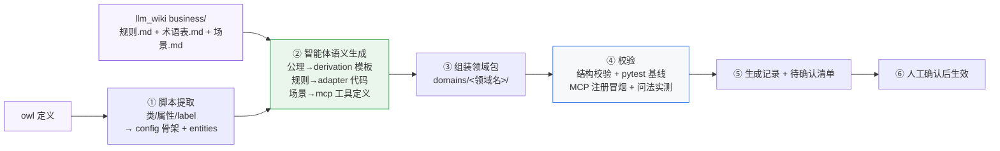

# 从 owl + llm_wiki 自动生成领域包

> 本文是 `KNOWLEDGE_BEYOND_OWL.md` 的配套篇：已知 owl 无法单独承载业务知识
> （那篇梳理了缺口），本篇回答"**如果已有 owl 定义 + 配套 llm_wiki 知识库，
> 能否由智能体自动补齐这些额外知识？llm_wiki 怎么设计？**"。
>
> 核心结论：**可以，但采用分层自动化**——能脚本提取的不麻烦 LLM，
> 能 LLM 生成的不靠人写，业务规则必须知识库先有，最终人工过目后生效。

---

## 1. 目标与核心思路

**目标**：给定「owl 本体定义 + llm_wiki 业务知识库」，智能体自动产出可运行的领域包
（`config.json` / `derivation.json` / `adapter.py` / `mcp.py`），
把 DESIGN.md 中"手动搭领域包"的过程降为"维护知识库 + 过目待确认项"。

**分层原则**（按知识的确定性依次降级）：

| 层 | 知识类型 | 生成方式 | 人工介入 |
|---|---|---|---|
| L1 确定性 | 类/属性/label 等本体元数据 | 脚本提取 | 无 |
| L2 语义性 | 公理→人话、工具描述、规则→代码 | LLM 生成 | 校验 + 抽查 |
| L3 业务性 | 聚合/禁止/阈值规则本身 | 知识库事实源 | **知识库必须先有** |
| L4 确认 | 全部产物的行为 | 测试 + 人工过目 | 待确认项确认后生效 |

**一句话**：不是"全自动"，而是"确定性交给脚本、语义性交给 LLM、
业务性交给知识库、安全性交给人工确认"。

---

## 2. 生成能力分层表

| 额外知识 | 输入 | 生成方式 | 自动化 | 校验方式 |
|---|---|---|---|---|
| config.json 类/属性名 | owl | 脚本（owlready2 读类层次/属性） | ✅ 全自动 | 断言类数/属性数与 owl 一致 |
| entities 短名⇄中文 | owl `rdfs:label` | 脚本提取 | ✅ 全自动 | 无空 label 校验 |
| 顶层类 / 隐藏类 | owl + 业务说明 | 规则判断（top-level / equivalentClass 定义类）+ LLM 兜底 | ⚠️ 大部分 | 人工过目 |
| derivation.json 叙述模板 | owl 公理 + 术语表 | LLM：公理→人话叙述 | ⚠️ 半自动 | 模板结构校验 + 推导链实测 |
| mcp.py 工具契约 | 查询能力清单 + 场景.md | LLM：能力+场景 → 工具名/描述/参数 | ⚠️ 半自动 | MCP 注册冒烟 + 描述抽查 |
| adapter.py 业务规则 | 规则.md（半结构化） | LLM：条件/动作 → 代码 | ⚠️ 依赖知识库 | pytest + 人工确认 |

**关键边界**：R2 聚合、R4 禁止、风险阈值在 owl 里没有，LLM 也不能凭空生成——
**规则必须显式存在于知识库**，智能体只负责"翻译"成代码，不负责"发明"规则。

---

## 3. llm_wiki 目录设计

一个领域对应一个知识空间（与代码 `domains/<领域名>/` 同名，天然对应）：

```
domains/<领域名>/                        ← llm_wiki 中的领域知识空间
├── ontology/
│   └── <name>.owl                      # 本体定义（含版本号，生成指纹来源）
├── business/                           # ★ 智能体生成"额外知识"的事实源
│   ├── 规则.md                         # 半结构化业务规则（见 4.1）
│   ├── 术语表.md                       # 短名⇄中文⇄owl 元素双向链接（见 4.2）
│   └── 场景.md                         # 典型问法 + 期望结果（见 4.3）
└── generated/                          # 自动产物，可再生成、不手工改
    ├── config.json
    ├── derivation.json
    ├── adapter.py
    ├── mcp.py
    └── 生成记录.md                     # 来源指纹 + 待确认项（见 4.4）
```

约定：`ontology/` 与 `business/` 是**人维护的事实源**；`generated/` 是**机器产物**，
改业务先改事实源、再重生成，避免"改产物又被打回"的循环。

---

## 4. 四个设计要点

### 4.1 规则.md：半结构化业务规则（LLM 可靠提取的前提）

规则文档必须字段化，LLM 才能稳定翻译成代码：

```markdown
## 规则 R4 合规约束
- 触发：任务 requires_constraint 含 ComplianceRequirement
- 条件：agent has_certified = false
- 动作：拒绝分配，返回冲突报告
- 示例：t_compliance_dev → junior_dev 冲突
- 依据：公司合规制度 v2.3

## 规则 分类-高风险
- 触发：任务（新建）
- 条件：has_risk_level >= 5
- 动作：归类为 HighRiskTask，加入高风险提示
- 示例：风险等级 6 的任务
- 依据：风险管理办法 v1.0
```

| 字段 | 用途 |
|---|---|
| 触发 | 决定规则挂在哪个查询/动作上 |
| 条件 | 翻译为 if 判断（引用 owl 属性名） |
| 动作 | 翻译为返回结构 / 图断言 |
| 示例 | 生成测试用例 |
| 依据 | 写入生成记录，可追溯 |

### 4.2 术语表.md：与 owl 双向链接（实体识别与短名映射的桥）

```markdown
## 研发Agent（dev_agent）
- owl: `<...#dev_agent>`（NamedIndividual，类型 DevAgent）
- 别名：开发人员 / R&D Agent
- 能力：Coding、CodeReview

## 编码实现（Coding）
- owl: `<...#Coding>`（Class，Capability 子类）
- 别名：编码 / 开发能力
```

设计要点：每个概念**标注对应 owl 元素（IRI + 类型）**，智能体生成 entities、
工具描述示例短名、derivation 模板时统一从这里取词，保证"短名⇄中文"全局一致。

### 4.3 场景.md：典型问法与期望结果（喂工具描述）

```markdown
## 能力匹配
- 问法："谁能做登录模块开发？" / "哪些智能体可以执行这个任务？"
- 期望工具：capability_match(task=t_login_dev)
- 期望结果：匹配 Agent 列表 + 推导链

## 合规检查
- 问法："这个合规任务可以分给开发吗？"
- 期望工具：assign(task=t_compliance_dev, agent=dev_agent)
- 期望结果：R4 冲突报告
```

设计要点：场景文档是 MCP 工具 description 的素材来源，也用于生成后
"问法→工具"冒烟测试——拿真实问法跑一遍，验证工具确实可达。

### 4.4 生成记录.md：来源指纹 + 待确认项（可审计、可增量）

```markdown
## 生成记录 2026-10-10
来源指纹：
- owl: agent_task_ontology.owl (sha256: ab12…)
- 规则.md: 4 条规则（R2/R4/分类-合规/分类-高风险）
- 术语表.md: 13 个体 / 25 类 / 12 属性
产物：config.json / derivation.json / adapter.py / mcp.py
校验：pytest 29/29 通过；MCP 14 工具注册冒烟通过
待人工确认：
- [ ] config.json 隐藏类（CertifiedAgent/ComplianceTask）
- [ ] adapter.py R4 冲突消息措辞
- [ ] mcp.py capability_match 描述示例短名
```

设计要点：记录"来源指纹"（owl 哈希、规则条数），owl 或规则变更时
**按指纹差异只重生成受影响部分**；"待确认项"是人工审核清单，未确认不静默生效。

---

## 5. 生成流水线（智能体执行）



**前置检查**（第 0 步）：owl 可加载（owlready2 解析通过）；`business/` 三件套齐全
（规则.md 字段完整、术语表无空 label、场景.md 有问法）。缺任一则中止并报告缺什么。

---

## 6. 增量更新策略

| 变更 | 影响范围 | 处理 |
|---|---|---|
| owl 加类/属性/个体 | config 骨架、entities、derivation 模板 | 重跑 ① 脚本 + 受影响模板 |
| owl 改公理（如加属性链） | derivation 模板、推理结果 | 重生成 ② + 全量 pytest |
| 规则.md 增删规则 | adapter.py、测试用例 | 重生成 ② + 新增用例校验 |
| 术语表改名 | entities、工具描述示例短名 | 重生成 ② + 问法冒烟 |
| 场景.md 增问法 | mcp 工具描述、冒烟用例 | 重生成 ② + 新问法实测 |

原则：**事实源驱动**——只改 `ontology/` 与 `business/`，`generated/` 整体可再生成；
生成记录里的指纹让智能体能判断"哪些产物过期了"。

---

## 7. 边界与权衡

| 维度 | 说明 |
|---|---|
| 生成上限 = 知识库质量 | 规则.md 越结构化，adapter 生成越可靠；纯散文的规则文档 LLM 提取不稳定 |
| 业务规则必须人工确认 | LLM 翻译"条件/动作"可能有偏差，pytest 覆盖常规路径，异常路径靠人过目 |
| 不是全自动 | 顶层类/隐藏类、冲突措辞、工具描述用词等语义判断留"待确认项" |
| 与手动流程的关系 | 自动生成跑通后，手动搭领域包流程降级为"兜底/修特殊场景" |

---

## 8. 与现有资产的关系

| 资产 | 关系 |
|---|---|
| `KNOWLEDGE_BEYOND_OWL.md` | 本篇的前提：为什么需要这些额外知识 |
| `DESIGN.md` | 领域包结构约定（config/derivation/adapter/mcp 放哪、怎么命名）是生成器的输出规范 |
| `REASONING.md` | 公理→人话叙述的知识基础（derivation 模板生成依据） |
| ontology-reasoning skill | 可扩展"生成流程"：给定 owl + 知识库 → 产出领域包，替代手动装配 |
| 现有测试基线 | pytest 29/29 是生成产物的验收闸门，生成后必须全绿才允许出包 |

---

*本文档与代码同步维护；目录规范与流水线为推荐设计，落地时以实际领域为准。*
