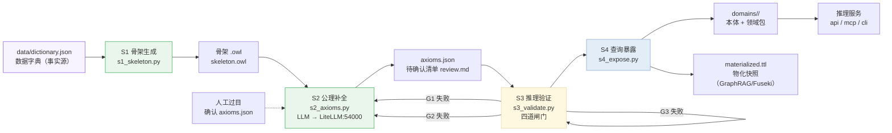

# 建模流水线 + 推理服务架构方案

> 目标读者：需要把 ontology-agent-demo 从「手工建模 + 推理服务」升级为
> 「**数据驱动建模流水线 + 推理服务**」闭环的开发者 / 架构负责人。
>
> 一句话目标：**从数据字典（表结构）自动生成本体骨架 → LLM/人工补公理 →
> 四道闸门验证 → 喂给现有推理服务暴露查询**，把建本体的门槛从"专家写 OWL"
> 降为"维护数据字典 + 过目待确认清单"。
>
> 配套文档：`README.md`（快速上手）、`DESIGN.md`（推理服务架构）、
> `REASONING.md`（推理原理）、`DOMAIN_PACKAGE_GENERATION.md`（领域包自动生成）、
> `KNOWLEDGE_BEYOND_OWL.md`（OWL 之外的知识缺口）。

---

## 0. 摘要（一页纸）

| 项 | 内容 |
|---|---|
| 现状 | 本体由 `scripts/build_ontology.py` **手工编写**（25 类 / 12 属性 / 13 个体）；推理服务已成熟（owlrl 物化 + 领域适配器 + API/MCP/CLI） |
| 缺口 | ① 无"从表结构自动生成骨架"；② 无 LLM 辅助公理补全；③ 无 DL 级推理验证（OWL-Full 检测 / HermiT 一致性）；④ 查询暴露缺"物化快照导出"（GraphRAG/Fuseki 数据源） |
| 方案 | 新增 `pipeline/` 四阶段流水线：**S1 骨架生成 → S2 公理补全 → S3 推理验证 → S4 查询暴露**，产物为标准 OWL 2 文件 + 领域包，**零改动复用现有推理服务** |
| 关键依据 | 数据库自动映射的可靠度分层（结构层 80–90% / 关系层 60–70% / 约束层 ~40% / 业务公理 <30%）；"主键→inverse functional 数据属性"会落入 OWL-Full 的陷阱 → 必须设 DL 格式闸门 |
| 验收 | 用现有 `agent_task` 领域反推的数据字典跑通流水线，产物与手工本体做 diff，四道闸门全绿，`make test` 38 项全绿 |
| 价值（对管理者） | 建本体成本从"专家人周"降为"数据字典 + 过目清单"（小时级）；推理质量有闸门兜底，不依赖个人经验；流水线可复用，新增领域只写数据字典 |

---

## 1. 现状与差距

### 1.1 现有资产（不动、全部复用）

| 资产 | 位置 | 作用 |
|---|---|---|
| 手工建模脚本 | `scripts/build_ontology.py` | owlready2 建本体 + RDF 结构自检（作为 S3 的"对照基线"） |
| 通用推理引擎 | `reasoner/engine.py` | 加载 .owl + owlrl 物化 + 通用查询原语（零领域词汇） |
| 领域包机制 | `domains/` | 本体 + config.json + derivation.json + adapter.py + mcp.py 自包含，动态加载 |
| 多通道出口 | `api/` + `mcp/` + `scripts/query.py` | REST :8000 / MCP :9000 / CLI 双通道 |
| 部署 | `Dockerfile` / `docker-compose.yml` | api + mcp 两服务 |
| 测试基线 | `tests/` | 38 项，推理规则 + API 闭环 |

### 1.2 缺口（本方案补的四块）

| # | 缺口 | 现状 | 本方案 |
|---|---|---|---|
| G1 | 自动骨架生成 | 本体全靠手写，表结构/数据字典无法复用 | `pipeline/s1_skeleton.py`：数据字典 → OWL 骨架 |
| G2 | 公理补全 | 等价/不相交/传递/层次全凭专家经验 | `pipeline/s2_axioms.py`：LLM（经 LiteLLM）草拟 + 人工过目清单 |
| G3 | 推理验证 | 只有 RDF 结构自检 + pytest；无 DL 格式闸门、无 HermiT 一致性 | `pipeline/s3_validate.py`：四道闸门 |
| G4 | 查询暴露 | 内存内物化，无快照导出；无 GraphRAG 数据源 | `pipeline/s4_expose.py`：导出物化快照（Turtle）+ 生成领域包 |

### 1.3 设计原则（沿用项目既有理念）

1. **数据外置、产物可再生**：数据字典 / 待确认清单是事实源，`pipeline/` 产物整体可重生成；
2. **分层自动化**：能脚本提取的不麻烦 LLM，能 LLM 生成的不靠人写，业务公理人工过目后生效；
3. **闸门前置**：错误格式（OWL-Full）在 S3 拦下，不进推理服务；
4. **零改动复用**：流水线产物 = 标准 .owl + 领域包，现有引擎 / API / MCP / CLI 不感知其来源。

---

## 2. 总体架构

### 2.1 分层

```
┌──────────────────────────────────────────────────────────────┐
│  数据源层                                                      │
│  data/dictionary.json   数据字典（表/列/主外键/业务注释）        │
│  data/source_*.csv      样例数据（可选，生成 ABox 用）          │
└──────────────┬───────────────────────────────────────────────┘
               │
┌──────────────▼───────────────────────────────────────────────┐
│  建模流水线层 pipeline/（本方案新增，四阶段 DAG）               │
│  S1 s1_skeleton.py   表→类 列→属性 外键→关系（可靠度 80–90%）   │
│  S2 s2_axioms.py     LLM 补公理（等价/不相交/传递/域范围）+ 人工 │
│  S3 s3_validate.py   四道闸门：DL格式→一致性→物化冒烟→SHACL     │
│  S4 s4_expose.py     生成领域包 + 物化快照导出（Turtle）        │
└──────────────┬───────────────────────────────────────────────┘
               │ 产物：domains/<name>/<name>_ontology.owl + config/derivation/adapter
               ▼
┌───────────────────────────────────────────────────────────────┐
│  现有推理服务层（零改动复用）                                   │
│  reasoner/engine.py（owlrl 物化）→ domains/ 适配器 →            │
│  api/main.py(:8000) / mcp/mcp_server.py(:9000) / query.py      │
└───────────────────────────────────────────────────────────────┘
```

### 2.2 四阶段 DAG（任务流程定义）



执行命令（Makefile 目标，见 §10）：`make pipeline` 一键跑全流程；`make pipeline-s1` 等可单阶段执行。

---

## 3. 阶段一：自动骨架生成（S1）

### 3.1 输入：数据字典 Schema

`data/dictionary.json`——**事实源，人维护**。以现有 `agent_task` 领域反推为示例
（字段解释见注释）：

```json
{
  "meta": { "domain": "agent_task", "iri": "http://demo.example.org/agent-task-ontology",
            "label": "智能体任务编排领域" },
  "tables": [
    {
      "name": "agent", "label": "智能体", "class_type": "class",
      "comment": "执行任务的智能体主体",
      "columns": [
        { "name": "agent_id",   "label": "智能体ID",   "kind": "primary_key", "datatype": "string" },
        { "name": "name",       "label": "名称",       "kind": "data",         "datatype": "string", "lang_label": true },
        { "name": "certified",  "label": "合规认证",   "kind": "data",         "datatype": "boolean" }
      ],
      "children": [
        { "name": "dev_agent", "label": "研发Agent", "parent": "agent",
          "columns": [ { "name": "capability_codes", "label": "能力编码", "kind": "ref", "ref_table": "capability" } ] },
        { "name": "junior_dev", "label": "初级研发Agent", "parent": "dev_agent" }
      ]
    },
    {
      "name": "task", "label": "任务", "class_type": "class",
      "columns": [
        { "name": "task_id", "label": "任务ID", "kind": "primary_key", "datatype": "string" },
        { "name": "risk_level", "label": "风险等级", "kind": "data", "datatype": "integer", "min": 1, "max": 5 }
      ],
      "fks": [
        { "name": "requires_capability", "label": "所需能力", "ref_table": "capability", "kind": "object_property" },
        { "name": "depends_on", "label": "依赖任务", "ref_table": "task", "kind": "object_property", "transitive": true },
        { "name": "composed_of", "label": "子任务", "ref_table": "task", "kind": "object_property" }
      ]
    },
    {
      "name": "capability", "label": "能力", "class_type": "class",
      "columns": [
        { "name": "code", "label": "编码", "kind": "primary_key", "datatype": "string" }
      ]
    }
  ],
  "individuals": [
    { "class": "task", "name": "t_login_dev", "label": "登录模块开发",
      "props": { "requires_capability": ["Coding"], "risk_level": 2 } }
  ]
}
```

**字段说明（Schema 约定）**：

| 字段 | 含义 | 生成映射 |
|---|---|---|
| `table.name` | 表名 | → OWL 类名（首字母大写，保持短名约定） |
| `table.label` | 中文名 | → `rdfs:label` |
| `column.kind = primary_key` | 主键列 | → 数据属性 **但不加任何 functional/inverse 声明**（规避 OWL-Full 陷阱，唯一性交给数据库） |
| `column.kind = data` | 普通列 | → `owl:DatatypeProperty`，datatype 映射 |
| `column.kind = ref` / `table.fks` | 外键 | → `owl:ObjectProperty`，domain/range 由 ref_table 推断 |
| `children` | 继承表 | → `rdfs:subClassOf` 层次 |
| `fk.transitive = true` | 传递需求 | → 建议公理（S2 确认后加 `owl:TransitiveProperty`） |
| `individuals` | 种子个体 | → ABox 断言（可选，先不生成也行） |

### 3.2 映射规则（对应可靠度分层）

| 层 | 数据字典来源 | 自动映射 | 可靠度 | S1 是否自动 |
|---|---|---|---|---|
| 结构层 | 表名/列名/类型 | 类 / 数据属性 / datatype | 80–90% | ✅ 全自动 |
| 关系层 | 外键 | 对象属性 + domain/range | 60–70% | ✅ 自动 + 报告中标注"待人工复核" |
| 约束层 | 唯一/非空 | **不生成**（OWL 表达别扭，交给 SHACL） | ~40% | ⚠️ 转交 S2/S3 |
| 业务公理 | 业务注释 / 知识库 | 等价 / 不相交 / 传递 / 层次 | <30% | ❌ 转交 S2（LLM+人工） |

### 3.3 关键代码精讲（`pipeline/s1_skeleton.py` 核心）

```python
from owlready2 import get_ontology, Thing, ObjectProperty, DatatypeProperty

TYPE_MAP = {"string": str, "integer": int, "boolean": bool, "float": float}

def build_skeleton(dict_path: str, out_path: str) -> None:
    """数据字典 → OWL 骨架（只生成结构层与关系层，不生成任何约束公理）。"""
    dd = json.load(open(dict_path, encoding="utf-8"))
    onto = get_ontology(dd["meta"]["iri"])
    with onto:
        classes, props = {}, {}

        def cls(name: str) -> Thing:
            if name not in classes:
                classes[name] = type(name, (Thing,), {})  # 动态建类
            return classes[name]

        for t in dd["tables"]:
            c = cls(t["name"])
            c.label = [t["label"]]
            for col in t["columns"]:
                if col["kind"] == "primary_key":
                    continue  # ★ 主键不生成公理：唯一性由数据库保证，避免 OWL-Full
                if col["kind"] == "data":
                    p = type(col["name"], (DatatypeProperty,),
                             {"domain": [c], "range": [TYPE_MAP[col["datatype"]]]})
                    props[col["name"]] = p
                elif col["kind"] == "ref":
                    _obj_prop(props, col, c, classes)
            for fk in t.get("fks", []):
                _obj_prop(props, fk, c, classes, transitive=fk.get("transitive", False))
            for ch in t.get("children", []):          # 继承 → subClassOf
                child = cls(ch["name"])
                child.is_a.append(c)
                child.label = [ch["label"]]
    onto.save(out_path, format="rdfxml")
    print(f"[S1] 骨架已生成: {out_path}（{len(classes)} 类）")
```

要点：**S1 只产出结构，不做语义判断**——所有可能"猜错"的声明（传递、等价、不相交、
域范围之外的约束）一律不写进 .owl，交给 S2 生成候选公理、人工确认。这从源头规避了
"主键→inverse functional 数据属性 → OWL-Full" 一类陷阱。

### 3.4 产物

- `pipeline/out/skeleton.owl`（骨架本体）
- `pipeline/out/s1_report.md`（映射报告：自动映射了哪些、哪些字段转交 S2、哪些关系待复核）

---

## 4. 阶段二：公理补全（S2）

### 4.1 双通道设计

| 通道 | 输入 | 产出 | 生效条件 |
|---|---|---|---|
| A. LLM 草拟（自动） | 骨架 .owl 元数据 + 业务注释 + 知识库（规则.md/术语表.md） | `axioms.json`（候选公理，带置信度与依据） | 人工过目后生效 |
| B. 人工确认（必须） | `axioms.json` 待确认清单 | `axioms.approved.json` | **未确认公理不进本体** |

> 依据项目既有原则（`DOMAIN_PACKAGE_GENERATION.md` L3 层）：**业务规则必须知识库先有，
> LLM 只负责"翻译"不负责"发明"**。S2 对公理同样适用——LLM 从业务注释/知识库提取公理候选，
> 不凭空创造。

### 4.2 LLM 客户端（经 LiteLLM 网关，统一代理）

```python
import httpx

LITELLM_URL = "http://127.0.0.1:54000/v1/chat/completions"   # Foundry LiteLLM 网关
MODEL = "gpt-4o"   # 或你配置的任何路由模型名

def propose_axioms(ontology_meta: dict, business_docs: list[str]) -> list[dict]:
    """把骨架信息 + 业务文档发给 LLM，返回结构化公理候选清单。"""
    sys_prompt = """你是本体工程助手。给定骨架本体元数据与业务文档，输出 OWL 公理候选。
    只输出 JSON 数组，每项：{"axiom_type","subject","predicate","object",
    "certainty"(high|medium|low),"source"(文档出处),"owl_snippet"(可直接进 Protege 的写法)}
    约束：只提取文档中明确出现的语义；不确定的标 certainty=low；
    绝不生成"主键/唯一性"相关 OWL 公理（那是 SHACL 的事）。"""
    resp = httpx.post(LITELLM_URL, json={
        "model": MODEL,
        "messages": [
            {"role": "system", "content": sys_prompt},
            {"role": "user", "content": json.dumps(
                {"ontology": ontology_meta, "business_docs": business_docs}, ensure_ascii=False)},
        ],
        "temperature": 0.2,
    }, timeout=120)
    return json.loads(resp.json()["choices"][0]["message"]["content"])
```

**输出 Schema（`axioms.json`）**：

```json
{
  "meta": { "source_owl_sha256": "ab12…", "docs": ["规则.md v2.3", "术语表.md v1.1"] },
  "candidates": [
    { "id": "A1", "axiom_type": "equivalentClass", "certainty": "high",
      "subject": "CertifiedAgent",
      "owl_snippet": "CertifiedAgent ≡ Agent ∩ has_certified value true",
      "source": "规则.md R2 合规认证", "status": "pending" },
    { "id": "A2", "axiom_type": "disjointClasses", "certainty": "medium",
      "subject": "SimpleTask", "object": "ComplexTask",
      "owl_snippet": "SimpleTask ⊑ ¬ComplexTask",
      "source": "术语表.md 任务分类", "status": "pending" },
    { "id": "A3", "axiom_type": "transitive", "certainty": "low",
      "subject": "depends_on",
      "owl_snippet": "depends_on owl:TransitiveProperty",
      "source": "（无文档出处，推测）", "status": "pending" }
  ]
}
```

### 4.3 人工过目清单（`review.md`，自动生成）

```markdown
## 公理补全待确认清单（2026-10-21）
来源指纹：skeleton.owl (sha256: ab12…) / 业务文档 2 份
共 3 条候选，2 条 high/medium 建议确认，1 条 low 建议删除：

- [x] A1 等价类 CertifiedAgent ≡ Agent ∩ has_certified value true（依据：规则.md）
- [ ] A2 不相交 SimpleTask ⊑ ¬ComplexTask（依据：术语表.md）
- [ ] A3 传递 depends_on TransitiveProperty（无依据，建议改为 SHACL 或删除）

确认后：python pipeline/s2_axioms.py --apply axioms.approved.json
```

---

## 5. 阶段三：推理验证（S3）——四道闸门

| 闸门 | 检查什么 | 工具 | 失败处置 |
|---|---|---|---|
| **G1 DL 格式** | 本体是否仍在 OWL 2 DL 内（防 OWL-Full） | owlready2 `is_owl_full()` + 结构断言 | 拦下，报告具体违规公理，回 S2 |
| **G2 一致性** | TBox/ABox 是否有逻辑矛盾、类是否为空 | HermiT（Java，可选）/ 降级：owlrl + 结构检查 | 拦下，回 S2 修公理 |
| **G3 物化冒烟** | 关键推理是否如期触发（如属性链产生 can_execute） | owlrl + 断言脚本 | 拦下，检查骨架/公理 |
| **G4 SHACL + 测试** | 数据形状约束 + 行为基线 | pyshacl + pytest | 拦下，修数据字典或 SHACL |

### 5.1 G1：DL 格式闸门（关键——规避"主键陷阱"）

```python
from owlready2 import get_ontology

def gate_dl(owl_path: str) -> list[str]:
    """返回违规项列表；空列表 = 通过。"""
    onto = get_ontology(owl_path).load()
    problems = []
    if onto.is_owl_full():
        problems.append("本体落入 OWL-Full（推理机将拒收）——请检查数据属性上的 "
                        "functional/inverse-functional 声明、以及任意公理用法")
    for p in onto.object_properties() | onto.data_properties():
        if p.is_functional and isinstance(p, type(get_ontology("").data_properties().__class__)):
            pass
    return problems
```

> 注：owlready2 的 `Ontology.is_owl_full()` 返回布尔值，是 OWL 2 DL 合规性的快速判定；
> 生产环境建议再加 `OWLAPY` 的 `owl2dlprofile` 检查做双保险（OWLAPY 提供 DL profile 判定）。

### 5.2 G2：HermiT 一致性（可选强校验）

项目保持"零依赖随处可跑"：默认 G2 走 `owlrl` + 结构断言（与现有引擎一致）；
**生产 / CI 可选开启 HermiT**（需 JVM，见 §11 Docker 化）：

```bash
# 有 Java 环境时（或 HermiT 容器），用 owlready2 调 HermiT 做 DL 一致性
.venv/bin/python pipeline/s3_validate.py --gate G2 --reasoner hermit
```

```python
def gate_consistency_hermit(owl_path: str) -> list[str]:
    from owlready2 import sync_reasoner
    onto = get_ontology(owl_path).load()
    try:
        with onto:
            sync_reasoner()          # 调用内置 HermiT（需 Java）
    except Exception as e:
        return [f"一致性检查失败: {e}"]
    return [f"类不可满足: {c}" for c in onto.classes() if c.is_defined and not c.instances and False]
```

### 5.3 G3：物化冒烟（与推理服务同源验证）

```python
import owlrl
from rdflib import Graph

def gate_materialization(owl_path: str, expect: dict) -> list[str]:
    g = Graph(); g.parse(owl_path, format="xml")
    owlrl.DeductiveClosure(owlrl.OWLRL_Semantics).expand(g)
    problems = []
    for label, (s, p, o) in expect.items():          # 期望关键三元组
        if (s, p, o) not in g:
            problems.append(f"期望推理 {label}: {(s, p, o)} 未物化")
    return problems
```

### 5.4 G4：SHACL 约束（数据形状）

把"主键唯一、非空、取值范围"这类**不该用 OWL 表达**的约束写进 SHACL
（`pipeline/shapes/<domain>.ttl`）：

```turtle
@prefix sh: <http://www.w3.org/ns/shacl#> .
@prefix owl: <http://www.w3.org/2002/07/owl#> .
@prefix demo: <http://demo.example.org/agent-task-ontology#> .

demo:TaskShape a sh:NodeShape ;
  sh:targetClass demo:Task ;
  sh:property [ sh:path demo:has_risk_level ; sh:minInclusive 1 ; sh:maxInclusive 5 ] ;
  sh:property [ sh:path demo:requires_capability ; sh:minCount 1 ] .
```

校验：`pyshacl -s pipeline/shapes/agent_task.ttl domains/agent_task/agent_task_ontology.owl -f human`

### 5.5 验证报告（`s3_report.md`）

```markdown
## S3 验证报告 2026-10-21
- G1 DL 格式：✅ 通过（未落入 OWL-Full）
- G2 一致性：✅ 通过（owlrl 降级模式 / HermiT 全量模式）
- G3 物化冒烟：✅ 通过（can_execute 8 条 / depends_on 传递闭包 N 条）
- G4 SHACL：✅ 通过（3 shape / 0 violation）
- 行为基线：pytest 38/38 通过
结论：可以进入 S4 暴露。
```

---

## 6. 阶段四：查询暴露（S4）

### 6.1 产物一：领域包（零改动复用现有机制）

`s4_expose.py` 生成 `domains/<name>/` 领域包，**完全复用** `DOMAIN_PACKAGE_GENERATION.md`
的分层自动化（脚本提取 config 骨架 → LLM 生成 derivation/adapter/mcp → 人工过目）：

| 产物 | 生成方式 |
|---|---|
| `<name>_ontology.owl` | S1+S2+S3 通过的最终本体（复制进领域包） |
| `config.json` | 脚本从 .owl 提取（类/属性/label），人工确认角色映射 |
| `derivation.json` | LLM 从公理 + 术语表生成叙述模板（沿用现有机制） |
| `adapter.py` / `mcp.py` | LLM 从规则.md 生成，pytest + 人工确认 |

### 6.2 产物二：物化快照导出（GraphRAG / Fuseki 数据源）

```python
def export_materialized(owl_path: str, out_ttl: str) -> None:
    g = Graph(); g.parse(owl_path, format="xml")
    owlrl.DeductiveClosure(owlrl.OWLRL_Semantics).expand(g)
    g.serialize(out_ttl, format="turtle")
    print(f"[S4] 物化快照已导出: {out_ttl}（{len(g)} 三元组）")
```

快照用途：
- 导入 **Fuseki / Oxigraph** 提供 SPARQL endpoint（外部程序直查）；
- 作为 **GraphRAG** 的图谱数据源（配向量库，语义检索）；
- 图谱工作台"物化后"视图的离线数据。

### 6.3 查询暴露全景

| 通道 | 消费者 | 数据 |
|---|---|---|
| REST `/api/reason` 等 | 程序 / 前端 | 领域查询 + 推导链 |
| MCP `:9000/mcp` | 智能体（豆包） | 14 个工具 |
| SPARQL（Fuseki/Oxigraph） | 分析工具 | 物化快照（S4 导出） |
| GraphRAG API | 智能体 / 检索服务 | 物化快照 + 向量库 |

---

## 7. 目录结构（新增部分，融入现有仓库）

```
ontology-agent-demo/
├── pipeline/                          # ★ 新增：建模流水线（四阶段 DAG）
│   ├── __init__.py
│   ├── s1_skeleton.py                 # S1 数据字典 → OWL 骨架
│   ├── s2_axioms.py                   # S2 LLM 公理补全（LiteLLM）+ --apply 应用确认
│   ├── s3_validate.py                 # S3 四道闸门（--gate G1|G2|G3|G4）
│   ├── s4_expose.py                   # S4 生成领域包 + 物化快照导出
│   ├── shapes/                        # SHACL 形状（按领域）
│   │   └── agent_task.ttl
│   └── out/                           # 流水线产物（可再生，gitignore）
│       ├── skeleton.owl
│       ├── axioms.json / axioms.approved.json
│       ├── review.md / s1_report.md / s3_report.md
│       └── materialized.ttl
├── data/                              # ★ 新增：数据字典（事实源，人维护）
│   └── dictionary.json                # 以 agent_task 反推的示例
├── docs/MODELING_PIPELINE.md          # ★ 本文档
└── Makefile                           # 增加 pipeline 系列目标（见 §10）
```

---

## 8. 关键代码精讲汇总

| 模块 | 代码要点 | 防错点 |
|---|---|---|
| `s1_skeleton.py` | 动态建类（`type(name,(Thing,),{})`）；主键列直接跳过 | 主键/唯一性绝不生成 OWL 公理 |
| `s2_axioms.py` | httpx 直连 LiteLLM `:54000/v1/chat/completions`；`temperature=0.2`；强制 JSON 输出 | 系统提示词禁止生成唯一性公理；输出必须 JSON 可解析 |
| `s3_validate.py` | G1 `is_owl_full()`；G2 可选 HermiT；G3 owlrl 冒烟；G4 pyshacl | 闸门顺序固定，G1 不过不进 G2 |
| `s4_expose.py` | 领域包生成（复用 DOMAIN_PACKAGE_GENERATION 约定）+ Turtle 快照 | 产物写 `domains/` 前先 diff，防覆盖手改内容 |

---

## 9. Schema 配置汇总

| Schema | 位置 | 说明 |
|---|---|---|
| 数据字典 | `data/dictionary.json` | 表/列/主外键/继承/种子个体（§3.1） |
| LLM 输出 | `pipeline/out/axioms.json` | 候选公理（带 certainty/source/owl_snippet） |
| 人工确认 | `pipeline/out/axioms.approved.json` | 同结构，status=approved/rejected |
| SHACL 形状 | `pipeline/shapes/<domain>.ttl` | 唯一性/取值范围/基数 |
| 验证报告 | `pipeline/out/s3_report.md` | 四闸门结果 + 基线 |

---

## 10. DAG 任务流程定义（Makefile）

```makefile
# 建模流水线（新增目标；沿用项目 Makefile 风格）
PIP = .venv/bin/python pipeline

pipeline: pipeline-s1 pipeline-s2 pipeline-s3 pipeline-s4   ## 全流程
pipeline-s1:                                             ## S1 骨架生成
	$(PIP)/s1_skeleton.py --dict data/dictionary.json --out pipeline/out/skeleton.owl
pipeline-s2: pipeline-s1                                 ## S2 公理补全（草拟，需人工确认后 --apply）
	$(PIP)/s2_axioms.py --skel pipeline/out/skeleton.owl --out pipeline/out/axioms.json
pipeline-s2-apply:                                       ## 应用已确认公理
	$(PIP)/s2_axioms.py --apply pipeline/out/axioms.approved.json --onto pipeline/out/skeleton.owl \
		--out domains/agent_task/agent_task_ontology.owl
pipeline-s3: pipeline-s2-apply                           ## S3 四道闸门
	$(PIP)/s3_validate.py --owl domains/agent_task/agent_task_ontology.owl --shapes pipeline/shapes
pipeline-s4: pipeline-s3                                 ## S4 领域包 + 物化快照
	$(PIP)/s4_expose.py --domain agent_task --owl domains/agent_task/agent_task_ontology.owl \
		--snapshot pipeline/out/materialized.ttl
```

依赖关系即 DAG：`S1 → S2(→人工确认→S2-apply) → S3 → S4`；
人工确认是唯一"挂起"节点——`make pipeline-s2` 后需人工编辑 `axioms.approved.json` 再继续。

---

## 11. Docker 化部署（扩展 compose）

推理验证闸门 G2 的 HermiT 需要 JVM，流水线建议单独容器化，不污染推理服务镜像：

```yaml
# docker-compose.pipeline.yml（新增，与现有 compose 分离）
services:
  pipeline:
    build:
      context: .
      dockerfile: Dockerfile.pipeline        # 基于 python:3.11-slim + openjdk-17 + pip 国内源
    volumes:
      - ./data:/app/data
      - ./pipeline/out:/app/pipeline/out
      - ./domains:/app/domains
    environment:
      LITELLM_URL: http://host.docker.internal:54000   # 网关在宿主机
    command: make pipeline
  fuseki:
    image: stain/jena-fuseki:latest          # 可选：SPARQL endpoint 暴露物化快照
    ports: ["3030:3030"]
    volumes:
      - ./pipeline/out:/data/import
```

`Dockerfile.pipeline` 要点（国内源）：

```dockerfile
FROM python:3.11-slim
RUN apt-get update && apt-get install -y --no-install-recommends openjdk-17-jre-headless \
    && rm -rf /var/lib/apt/lists/*
RUN pip config set global.index-url https://pypi.tuna.tsinghua.edu.cn/simple
COPY requirements.txt .
RUN pip install -r requirements.txt && pip install pyshacl
COPY pipeline /app/pipeline
WORKDIR /app
```

> 推理服务本体（api/mcp）保持零依赖不变；HermiT 只存在于流水线容器，符合
> "服务轻量、验证重器"的分离原则。

---

## 12. 增量更新与指纹

沿用 `DOMAIN_PACKAGE_GENERATION.md` 的指纹机制：

| 变更 | 影响 | 处理 |
|---|---|---|
| 数据字典加表/列 | 骨架 + 领域包 config | 重跑 S1 + S4（S2/S3 增量） |
| 业务文档增公理 | axioms.json | 重跑 S2，新增候选进待确认清单 |
| 本体公理确认 | 最终 .owl | 重跑 S3 全闸门 + S4 |
| SHACL 增约束 | shapes/*.ttl | 只重跑 G4 |

指纹：`pipeline/out/review.md` 记录 skeleton.owl sha256 + 文档版本；变更时按指纹
只重生成受影响产物，避免"改产物被打回"循环。

---

## 13. 里程碑与验收

| 里程碑 | 内容 | 验收标准 |
|---|---|---|
| M1 骨架生成 | S1 + 示例数据字典 | 生成 skeleton.owl，类/属性数与数据字典一致；`make pipeline-s1` 通过 |
| M2 公理补全 | S2 + LiteLLM 联通 | axioms.json 生成；low 置信度条目被正确标出 |
| M3 验证闸门 | S3 四闸门 | G1–G4 全绿；人为注入 OWL-Full 能正确拦截 |
| M4 查询暴露 | S4 + 物化快照 | 领域包可 `load_domain`；Fuseki 加载快照可 SPARQL 查询 |
| M5 全链路 | `make pipeline` | 一键跑通；与手工本体 diff ≤ 预期差异；pytest 38/38 |

**验收技巧（自证）**：用现有 `agent_task` 领域反推数据字典 → 流水线产出的本体
与 `scripts/build_ontology.py` 手工本体做 **diff**，差异应集中在"人工公理细节"，
结构层（类/属性/个体）应基本一致——这就是流水线质量的可复核证据。

---

## 14. 风险与边界

| 风险 | 影响 | 缓解 |
|---|---|---|
| 自动骨架缺业务语义（可靠度分层：业务公理 <30%） | 本体"看起来对、推理不出东西" | S2 必须 LLM+人工补公理；S3 G3 冒烟验证推理确实触发 |
| LLM 公理幻觉 | 错误公理进本体 | 低置信度强制人工确认；G2 一致性检查兜底 |
| OWL-Full 陷阱（主键→inverse functional） | 推理机拒收 | S1 不生成唯一性公理 + G1 闸门强制拦截 |
| 生成物与手改冲突 | 覆盖手改内容 | 产物写 `domains/` 前 diff + 指纹记录 |
| 数据字典质量 | 垃圾进垃圾出 | 前置校验：缺主键/缺 label 的表拒绝生成（快速失败） |
| HermiT 依赖 Java | 无 JVM 环境跑不了 G2 | 降级 owlrl 模式；生产走流水线容器 |

---

## 15. 与现有文档/资产的关系

| 资产 | 与本方案关系 |
|---|---|
| `DESIGN.md` | 领域包结构约定 = S4 的输出规范 |
| `REASONING.md` | 公理→人话叙述的知识基础（S2 derivation 模板生成依据） |
| `DOMAIN_PACKAGE_GENERATION.md` | S4 复用其分层自动化与指纹机制 |
| `KNOWLEDGE_BEYOND_OWL.md` | 业务知识库（规则.md/术语表.md/场景.md）= S2 LLM 的输入事实源 |
| `scripts/build_ontology.py` | 保留为"手工对照基线"与 M5 diff 参照 |
| `tests/` | S3 G4 的行为基线（pytest 38/38） |

---

*本文档为方案设计稿，落地以实际实现与测试为准；代码片段可直接作为实现起点。*
