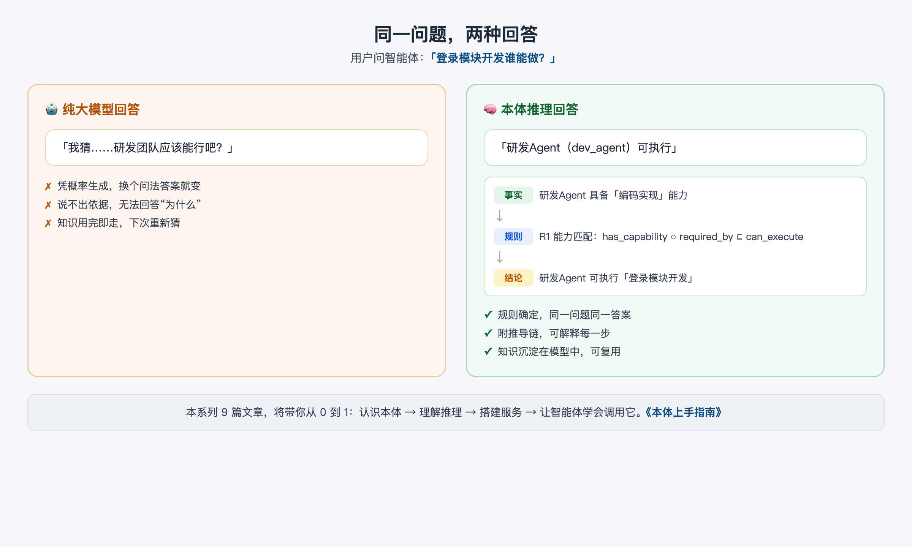
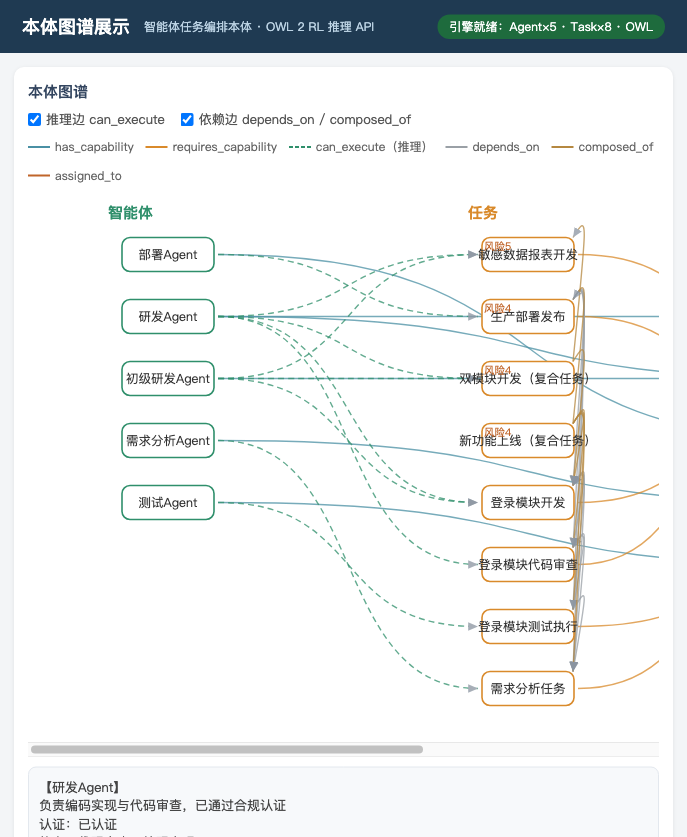

# 00 为什么需要本体

> 阅读时长：约 8 分钟 · 配套动手：约 5 分钟
> **读完你能**：说清"为什么要用本体"，并看懂本系列的学习路径

---

## 一个真实场景

假设你是一个 AI 应用的使用者，你问智能体：

> **「登录模块开发谁能做？」**

纯大模型的做法是——凭概率"猜"一个答案；而接入本体的做法是——给出确定答案，并把依据一步步摆给你看：



同样的一个问题，右侧的回答来自一个 **本体（Ontology）**：它先查事实（研发 Agent 具备"编码实现"能力），再套规则（R1 能力匹配），最后推出结论。每一步都有据可查，换个问法结果也一样。

这就是本系列要带你掌握的东西。

## 三个痛点

先问一个问题：**为什么我们需要本体？** 答案藏在大模型应用的三个痛点里。

| 痛点 | 表现 |
|---|---|
| **结果不确定** | 同一个问题，换个措辞、换个时间问，答案可能就变了；涉及任务分配、权限判定、合规检查时，这种"概率式回答"很危险 |
| **不可解释** | 大模型说不出自己为什么这么答；而"为什么"恰恰是生产系统里最常被追问的 |
| **知识不沉淀** | 知识散落在一次次的对话里，用完即走；换一个智能体、换一个场景，又要重新说一遍 |

> 需要澄清的是：本文并不否定大模型。恰恰相反，本系列的主角是**大模型 + 本体**的组合——大模型负责理解和表达，本体负责确定性和可解释。

## 本体的承诺

本体能补齐上面三个短板，靠的是三个特性：

1. **确定性**：结论由"事实 + 规则"推出，同一输入必然得到同一输出，不靠概率。
2. **可解释**：每次推理都附带一条**推导链**——"事实 → 规则 → 结论"，能直接回答"为什么选它"。
3. **可复用**：知识以标准文件（`.owl`）形式沉淀下来，任意服务、任意智能体都能加载同一份模型，不重复造轮子。

这正是本仓库「本体 × 智能体协作 Demo」的设计理念（摘自项目 README）：

> 用户用自然语言提问，**智能体负责理解与编排**（把问题翻译成对推理 API 的调用），**本体负责给出确定性、可解释的推理结论**，智能体再把结论组织成回答。全程可视化展示「事实 → 规则 → 结论」的推导链。

简单说：**智能体负责"听懂人话"，本体负责"算得准、讲得清"。**

## 本系列的学习路径

《本体上手指南》共 9 篇，四大模块递进。你不需要任何本体基础，跟着走完就能亲手把一套本体推理服务跑起来，并让智能体学会调用它。

| 模块 | 篇目 | 你将获得 |
|---|---|---|
| **A 概念与示例** | 篇 0 为什么需要本体（本篇） | 理解本体的价值 |
| | 篇 1 本体入门：类、个体、属性与关系 | 读懂一个 .owl 文件 |
| | 篇 2 解剖示例本体：智能体任务编排 | 看清"这个本体里有什么" |
| **B 推理与图谱** | 篇 3 本体推理原理：从公理到推导链 | 理解机器如何"推出"结论 |
| | 篇 4 本体与知识图谱：一张图看懂 | 讲清本体和图的区别 |
| **C 服务搭建** | 篇 5 半小时搭建本体推理服务 | 独立跑起 REST API + CLI |
| | 篇 6 用 MCP 把本体服务接入智能体 | 把服务接入豆包对话 |
| **D 智能体应用** | 篇 7 智能体 × 本体协作实战 | 设计自己的"智能体+本体"应用 |
| | 篇 8 把本体服务变成你自己的 | 换本体、新建领域、加规则 |

## 动手：把它跑起来

趁热打铁，先用 5 分钟把 Demo 跑起来，亲眼看看本体长什么样。

```bash
cd ontology-agent-demo

# 1. 创建虚拟环境并安装依赖（首次）
python3 -m venv .venv
.venv/bin/pip install -r requirements.txt

# 2. 启动推理 API + Demo 页面
.venv/bin/uvicorn api.main:app --host 127.0.0.1 --port 8000
```

打开浏览器访问 **http://127.0.0.1:8000**，你会看到一个"智能体任务编排本体"的图谱可视化页面：



左侧是智能体，右侧是任务，连线表示能力、依赖与推理关系。页面顶上会显示"引擎就绪：Agent×5 · Task×8"——这就是本体里已有的知识。

然后，在 Demo 页面里依次体验下面这 6 种问法，感受"智能体理解问题 → 本体推理 → 给出推导链"的完整链路：

| # | 问法 | 智能体做什么 | 本体推理做什么 |
|---|---|---|---|
| 1 | 「登录模块开发谁能做？」 | 识别任务实体 | R1 能力匹配（属性链） |
| 2 | 「新功能上线怎么安排？」 | 拆解任务链 | R3 依赖传递 + 逐环节匹配 |
| 3 | 「把合规报表开发分配给初级研发」 | 执行分配 | R4 合规冲突检测 |
| 4 | 「为什么选研发 Agent？」 | 追问上一步 | 返回推导链（事实→规则→结论） |
| 5 | 「检查一下有没有冲突」 | 触发检查 | 一致性检查 |
| 6 | 「介绍一下这个本体」 | 读取本体概览 | 结构导出 |

> 提示：现在看不懂没关系，先混个眼熟。后面的文章会把图谱上的每一个类、每一条连线、每一次推理都拆开讲清楚。

## 小结

1. 大模型应用有三个痛点：**结果不确定、不可解释、知识不沉淀**。
2. 本体用**确定性、可解释、可复用**三个特性补上短板；本系列倡导的是"**智能体 + 本体**"协作，而不是二选一。
3. 你已经跑通了 Demo，看到了真实的本体图谱和 6 种推理问法——接下来从篇 1 开始，正式学习本体的基本概念。

**常见问题**

- **Q：本体和数据库有什么区别？**
  A：数据库负责"存"和"查"；本体除了组织知识，还能用规则**推理**出没存过的结论（比如"研发 Agent 可执行登录开发"并不是手工存进去的）。具体差别在篇 4 讲透。
- **Q：需要先学会 OWL 或 Protege 吗？**
  A：完全不需要。本系列从零开始，篇 1 只用"类、个体、属性"三个词就能讲清本体的骨架；Protege 只是篇 2 的一个可选工具。

---
**下一篇**：篇 1《本体入门：类、个体、属性与关系》——用三个词读懂本体的骨架。
