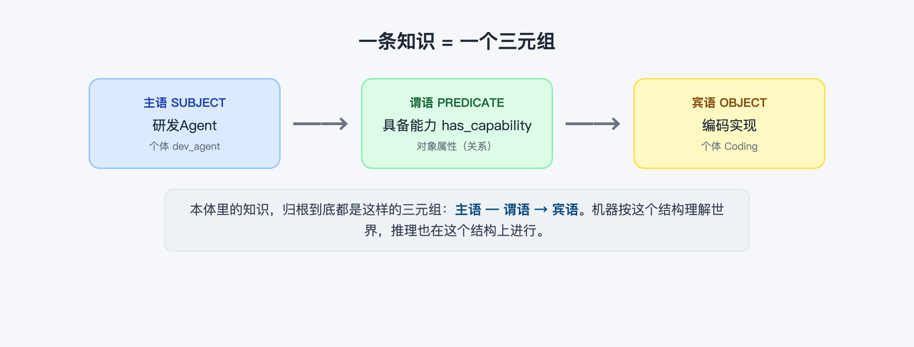
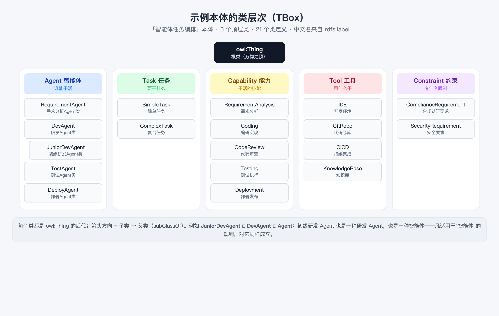

# 01 本体入门：类、个体、属性与关系
> 本文是《本体上手指南》系列第 2 篇（共 9 篇），零基础入门「本体 × 智能体」。

> 阅读时长：约 12 分钟 · 配套动手：约 5 分钟
> **读完你能**：用"类、个体、属性"三个词描述任何本体，并读懂一个 `.owl` 文件的基本结构

---

## 一句话定义

**本体（Ontology）** 是对"共享概念模型"的形式化描述。听起来绕口，拆开看只有三层意思：

- **概念模型**：不是一堆数据，而是关于"世界上有哪些概念、概念之间是什么关系"的结构约定；
- **共享**：同一份模型，多个系统、多个智能体都能引用，不重复造轮子；
- **形式化**：用机器可读的标准格式（如 OWL）写下来，能加载、能查询、能推理。

通俗地讲：**本体就是用机器能处理的方式，把"世界长什么样"写清楚。**

## 机器理解世界的单位：三元组

本体里的一切知识，归根到底都是 **三元组（Triple）**：**主语 — 谓语 → 宾语**。



用项目里的例子：

> **研发Agent — 具备能力（has_capability）→ 编码实现**

翻译成人话就是"研发 Agent 具备编码实现这个能力"。机器不靠语感，就靠这种"主语-谓语-宾语"的固定结构来理解世界——这也是后面所有推理的底层结构。

## 三大构件

三元组里反复出现的"主语、宾语、谓语"，对应着本体的三大构件：

| 构件 | 英文 | 是什么 | 示例本体里的例子 |
|---|---|---|---|
| **类** | Class | 概念的类别（模板） | 智能体 Agent、任务 Task、能力 Capability |
| **个体** | Individual | 具体的实例（实例） | 研发Agent（dev_agent）、登录模块开发（t_login_dev） |
| **属性** | Property | 个体与个体之间的关系 | has_capability（具备能力）、depends_on（依赖） |

区分"类"和"个体"是本体的第一关：

- **类**是"类别"：`DevAgent（研发Agent类）` 描述的是"一类智能体"；
- **个体**是"具体的人/事"：`dev_agent` 是知识库里那一个具体的研发 Agent。

一句话：**类是模板，个体是实例。** 一个本体里，类往往只有几十个，个体可以成百上千。

## 类层次：概念也有家族

类不是孤立的，它们之间有继承关系，称为 **类层次（Class Hierarchy）**。在 OWL 里用 `rdfs:subClassOf`（子类）表达：子类是父类的一种特化。



看左侧的智能体分支：

> **JuniorDevAgent（初级研发Agent类） ⊑ DevAgent（研发Agent类） ⊑ Agent（智能体）**

这条链的含义很朴素，但也很关键：**初级研发 Agent 也是一种研发 Agent，也是一种智能体**。因此——凡是适用于"智能体"的规则和约束，对它同样成立。这个"继承"特性，正是后面推理能"举一反三"的基础（篇 3 会看到它如何起作用）。

示例本体共 21 个类定义，5 个顶层类：`Agent`（谁能干活）、`Task`（要干什么）、`Capability`（干活的技能）、`Tool`（用什么干）、`Constraint`（有什么限制）。

## 中文名从哪来：rdfs:label

打开 `.owl` 文件，你会看到类名是英文短名（`Agent`、`DevAgent`），中文名并不写在类名里，而是放在 **`rdfs:label`** 标签中。这是本项目的硬约定：**owl 是中文名的唯一事实源**。

以 `DevAgent` 为例，它在文件里的真实声明是这样的：

```xml
<owl:Class rdf:about="#DevAgent">
  <rdfs:subClassOf rdf:resource="#Agent"/>
  <rdfs:label rdf:datatype="http://www.w3.org/2001/XMLSchema#string">研发Agent类</rdfs:label>
</owl:Class>
```

**第一次读 OWL 文件，按这个顺序看**（.owl 是 XML 格式，由一对对"标签"嵌套组成）：

| XML 写法 | 含义 | 通俗理解 |
|---|---|---|
| `<owl:Class ...> ... </owl:Class>` | 声明一个类（开标签 + 内容 + 结束标签） | "我要定义一个概念类别" |
| `rdf:about="#DevAgent"` | 这个类的**名字（ID）**；`#` 表示"本文件内" | 给类起唯一的名字 |
| `<rdfs:subClassOf rdf:resource="#Agent"/>` | 声明父类；`rdf:resource` 表示**引用文件里另一个 ID** | "DevAgent 是 Agent 的一种" |
| `<rdfs:label ...>研发Agent类</rdfs:label>` | 给人看的中文名，写在标签中间 | 显示用的中文标签 |

**把这段 XML 翻译回三元组**——上面 4 行 XML 等价于 3 条三元组：

```
DevAgent  rdf:type        owl:Class      （DevAgent 是一个类）
DevAgent  rdfs:subClassOf Agent          （DevAgent 是 Agent 的子类）
DevAgent  rdfs:label      "研发Agent类"   （DevAgent 的中文名）
```

> `rdf:type` 是"是一个"的标准写法，你在篇 2、篇 4 的 SPARQL 里会再见到它。

为什么要这样分？因为**标识要稳定、全球唯一（IRI），而中文名只是给人看的标签**。机器认 ID，人看标签——两者分开，改名不伤结构。

## 用示例本体串一遍

现在把你刚学到的三个词，套到示例本体上：

| 顶层类 | 中文 | 子类 | 个体举例 |
|---|---|---|---|
| `Agent` | 智能体 | 需求分析 / 研发 / 初级研发 / 测试 / 部署 Agent 类 | `req_agent`、`dev_agent`、`junior_dev` |
| `Task` | 任务 | 简单任务、复合任务 | `t_login_dev`（登录模块开发）、`t_feature`（新功能上线） |
| `Capability` | 能力 | 需求分析、编码实现、代码审查、测试执行、部署发布 | `Coding` 等 |
| `Tool` | 工具 | IDE、代码仓库、CICD、知识库 | `IDE`、`GitRepo` |
| `Constraint` | 约束 | 合规认证要求、安全要求 | `ComplianceRequirement` |

类与类之间也有关系，例如 `Agent — has_capability → Capability`（智能体具备能力），`Task — requires_capability → Capability`（任务需要能力）。这些"类级的关系约束"定义了世界的规则骨架；具体到个体级，就成了篇 0 里的三元组："研发Agent — has_capability → 编码实现"。

## 动手：打开 .owl 亲眼看看

**方式一：看文件。** 用任意文本编辑器打开 `domains/agent_task/agent_task_ontology.owl`，搜索 `DevAgent`，你就能看到上面那段 XML——试着再搜 `JuniorDevAgent`，验证它确实声明了 `subClassOf DevAgent`。

**方式二：问机器。** 启动服务后（命令见篇 0），用 API 直接查全部类层次：

```bash
curl -s -X POST http://127.0.0.1:8000/api/classes | python3 -m json.tool
```

返回的每一行 `{name, label, parent}`，就是上图里一个类节点和它的父类。

**方式三：看图谱。** 打开 Demo 页（http://127.0.0.1:8000），左侧"智能体"、右侧"任务"——这就是类 `Agent` 与 `Task` 下的个体们（ABox），下一篇会专门解剖它们。

## 小结

1. **本体 = 类 + 个体 + 属性**（+ 规则，篇 3 登场）；知识以三元组为单位。
2. **类层次**让概念有家族：子类继承父类的所有性质，这是推理"举一反三"的基础。
3. **英文短名是 ID，中文名放 `rdfs:label`**——.owl 是中文名的唯一事实源。

**常见问题**

- **Q：为什么类名不用中文？**
  A：类名其实是全球唯一的 IRI（如 `http://demo.example.org/agent-task-ontology#DevAgent`），文件里简写为 `#DevAgent`。标识要稳定，中文名只是标签，两者分离更利于跨系统共享。
- **Q：属性也有层次吗？**
  A：可以（`rdfs:subPropertyOf`），示例本体暂未用到；属性还可以有方向（`depends_on` 的逆属性等），这些在篇 2、篇 3 会涉及。

## 附录：本文用到的 OWL 语法

读者可能是第一次见 OWL 文件，这里把本文出现过的语法集中列成速查表。后续每篇结尾的"附录"只列该篇**新出现**的语法；重复出现的用 ★ 标注"篇 1 已学"。

| 语法 | 作用 | 例子 | 对应的三元组 |
|---|---|---|---|
| `rdf:RDF` 根 + `xmlns` | 文件的外壳：声明用到的命名空间 | `<rdf:RDF xmlns:rdf="...rdf-syntax-ns#" xmlns:owl="...owl#">` | —（文件外壳，不产生知识） |
| `<owl:Class rdf:about="#X">` | 声明"X 是一个类" | `<owl:Class rdf:about="#DevAgent">` | `X rdf:type owl:Class` |
| `<rdfs:subClassOf rdf:resource="#Y"/>` | 声明"X 是 Y 的子类" | 见正文 DevAgent 例子 | `X rdfs:subClassOf Y` |
| `<rdfs:label>中文</rdfs:label>` | 给 X 加中文名（给人看） | `研发Agent类` | `X rdfs:label "研发Agent类"` |
| `rdf:about` / `rdf:resource` | 定义一个新 ID / 引用一个已有 ID | `#DevAgent`（定义）、`#Agent`（引用） | —（ID 的写法） |

> 记忆口诀：**"是什么"由 `owl:Class` 说，"是谁的子类"由 `subClassOf` 说，"给人看的名字"写在 `label` 里。** 下一篇用同样的读法解剖示例本体的全部类、个体与属性。

---
**下一篇**：篇 2《解剖示例本体：智能体任务编排》——把 9 个属性、13 个个体的"关系网"完整摊开。