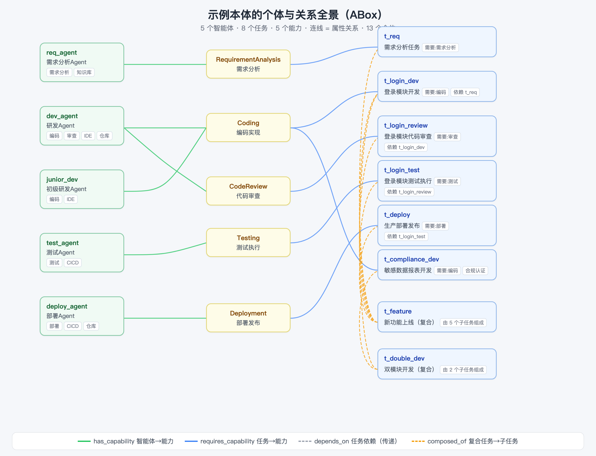

# 02 解剖示例本体：智能体任务编排
> 本文是《本体上手指南》系列第 3 篇（共 9 篇），零基础入门「本体 × 智能体」。

> 阅读时长：约 12 分钟 · 配套动手：约 5 分钟
> **读完你能**：完整描述"这个本体里有什么"——9 个属性、13 个个体的关系网，并看懂 TBox 与 ABox 的区别

---

## 业务背景

这个示例本体描绘的是一个 **研发团队 + 任务编排** 的场景：

- 团队里有 5 类智能体：需求分析、研发、初级研发、测试、部署；
- 他们承接各种任务：登录模块开发、新功能上线、敏感数据报表开发……；
- 每个任务需要特定能力，任务之间还有依赖顺序，有的任务还带合规约束。

本体要回答的核心问题就是：**谁有能力做这件事？事情该按什么顺序做？分配合不合规？**

把"谁有什么能力、任务需要什么、谁依赖谁、有什么限制"建模成一张图，就是下面这张全景：



> 图中：绿色连线 = 智能体具备的能力（has_capability），蓝色连线 = 任务需要的能力（requires_capability），灰色虚线 = 任务依赖（depends_on），橙色虚线 = 复合任务的组成（composed_of）。

## 九大对象属性

图中所有连线，都来自本体的 **9 个对象属性（Object Property）**。它们定义了关系的"方向"和"含义"：

| 属性 | 方向 | 含义 | 个体级示例 |
|---|---|---|---|
| `has_capability` | Agent → Capability | 智能体**具备**某能力 | dev_agent 具备「编码实现」 |
| `requires_capability` | Task → Capability | 任务**需要**某能力 | t_login_dev 需要「编码实现」 |
| `required_by` | Capability → Task | `requires_capability` 的**逆属性** | 「编码实现」被 t_login_dev 需要 |
| `depends_on` | Task → Task | 任务**依赖**前置任务（可传递） | t_login_dev 依赖 t_req |
| `composed_of` | ComplexTask → Task | 复合任务**由**子任务组成 | t_feature 由 5 个子任务组成 |
| `can_execute` | Agent → Task | 智能体**可执行**任务（推理产出） | 推理：dev_agent 可执行 t_login_dev |
| `assigned_to` | Task → Agent | 任务**分配给**智能体（运行时写入） | assign 操作后产生 |
| `requires_constraint` | Task → Constraint | 任务**受**约束限制 | t_compliance_dev 受「合规认证要求」 |
| `uses_tool` | Agent → Tool | 智能体**使用**工具 | dev_agent 使用 IDE |

注意看：有的属性是"天生"写进文件的（前 6 行），有的不是——`can_execute` 和 `assigned_to` 在 `.owl` 文件里**根本不存在**。它们一个是推理出来的，一个是运行时写入的。这个细节是理解本体的钥匙，稍后细说。

## 个体清单

本体里共 **13 个个体**（5 个智能体 + 8 个任务），中文名同样来自 `rdfs:label`：

**智能体（5 个）**

| 短名 | 中文 | 类型 | 具备能力 | 使用工具 |
|---|---|---|---|---|
| `req_agent` | 需求分析Agent | RequirementAgent | 需求分析 | 知识库 |
| `dev_agent` | 研发Agent | DevAgent | 编码实现、代码审查 | IDE、代码仓库 |
| `junior_dev` | 初级研发Agent | JuniorDevAgent | 编码实现 | IDE |
| `test_agent` | 测试Agent | TestAgent | 测试执行 | CICD |
| `deploy_agent` | 部署Agent | DeployAgent | 部署发布 | CICD、代码仓库 |

**任务（8 个）**

| 短名 | 中文 | 类型 | 需要能力 | 依赖 / 约束 |
|---|---|---|---|---|
| `t_req` | 需求分析任务 | SimpleTask | 需求分析 | — |
| `t_login_dev` | 登录模块开发 | SimpleTask | 编码实现 | 依赖 t_req |
| `t_login_review` | 登录模块代码审查 | SimpleTask | 代码审查 | 依赖 t_login_dev |
| `t_login_test` | 登录模块测试执行 | SimpleTask | 测试执行 | 依赖 t_login_review |
| `t_deploy` | 生产部署发布 | SimpleTask | 部署发布 | 依赖 t_login_test |
| `t_compliance_dev` | 敏感数据报表开发 | SimpleTask | 编码实现 | **合规认证要求** |
| `t_feature` | 新功能上线 | ComplexTask | — | 由 5 个子任务组成 |
| `t_double_dev` | 双模块开发 | ComplexTask | — | 由 2 个子任务组成 |

> 短名（如 `dev_agent`）是机器用的 ID；中文名（如"研发Agent"）是给人看的标签。后续所有 API、MCP、CLI 都同时支持这两种称呼。

## 一个关键观察：owl 里没有 can_execute

如果你把整个 `.owl` 文件翻一遍，会发现个体声明里只有 `has_capability`、`requires_capability`、`depends_on`、`composed_of`、`requires_constraint`、`uses_tool` 这 6 类事实——**没有任何一条 `can_execute`（可执行）**。

但 Demo 页面却能回答"登录模块开发谁能做？"。这说明什么？

> **`can_execute` 不是"存"出来的，是"推"出来的。**

本体里只存了"谁具备什么能力"（如 dev_agent 具备编码实现）和"任务需要什么能力"（如 t_login_dev 需要编码实现），"谁可执行哪个任务"这个结论，由**推理规则**自动得出。这正是本体区别于普通数据库的核心——篇 3 会完整拆解这条推理链。

同理，`assigned_to`（分配给谁）也不在文件里：它是运行时执行"分配"操作后写入引擎内存的。

## TBox 与 ABox：规则 vs 事实

学到这里，可以给你补上本体界最常用的两个术语：

| | 全称 | 是什么 | 例子 | 对应本篇哪张图 |
|---|---|---|---|---|
| **TBox** | Terminological Box | **类的结构**（世界规则） | "智能体具备能力（has_capability 的方向与含义）" | 篇 1 的类层次图 |
| **ABox** | Assertional Box | **个体的断言**（当前事实） | "dev_agent 具备编码实现" | 本篇的全景图 |

一句话：**TBox 是规则，ABox 是事实；推理把两者结合起来，得出新结论。**

## 动手：把关系网查出来

启动服务（命令见篇 0）后，用通用查询接口把这张图"问"出来：

```bash
# 1. 看图谱数据（类、个体、边，就是全景图的 JSON 版）
curl -s http://127.0.0.1:8000/api/ontology | python3 -m json.tool | head -50

# 2. 列出全部任务个体
curl -s -X POST http://127.0.0.1:8000/api/individuals \
  -H "Content-Type: application/json" -d '{"class_name":"Task"}'

# 3. 查某个个体的属性取值
curl -s -X POST http://127.0.0.1:8000/api/property \
  -H "Content-Type: application/json" \
  -d '{"subject":"dev_agent","property":"has_capability"}'
```

**（可选）用 Protege 打开：** 安装 Protege（配 Java）后直接打开 `domains/agent_task/agent_task_ontology.owl`——`Classes` 标签页看 TBox（类层次），`Individuals` 标签页看 ABox（个体与属性），跑 HermiT 推理器还能看到 `can_execute` 被推出来。本系列其他篇都不依赖 Protege，它只是进阶观察工具。

## 小结

1. **9 个属性织成关系网**：能力（has/requires）、依赖（depends_on）、组成（composed_of）、约束（requires_constraint）、执行（can_execute）、分配（assigned_to）、工具（uses_tool）。
2. **13 个个体是 ABox 事实**；`can_execute` 有意缺席——它是推理产出，不是存储数据。
3. **TBox 是规则，ABox 是事实**：推理 = 用规则处理事实，得出新结论（下一篇的主角）。

**常见问题**

- **Q：`has_capability` 和 `requires_capability` 有什么区别？**
  A：一个说"我有"（智能体视角），一个说"我需要"（任务视角），方向正好相反。把它俩"接起来"就能推出"谁能做"——这就是篇 3 的 R1 属性链。
- **Q：8 个任务的短名记不住怎么办？**
  A：不用记。MCP 里有 `entities` 工具、API 有 `/api/individuals` 随时枚举；这里的表格只是帮你建立直觉。

---
**下一篇**：篇 3《本体推理原理：从公理到推导链》——揭晓 `can_execute` 是如何被"推"出来的。