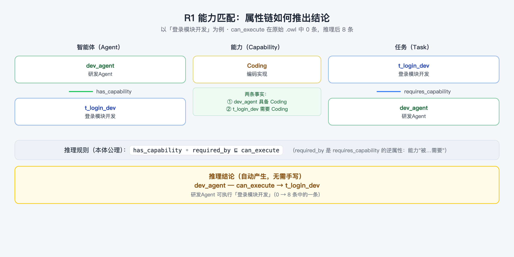
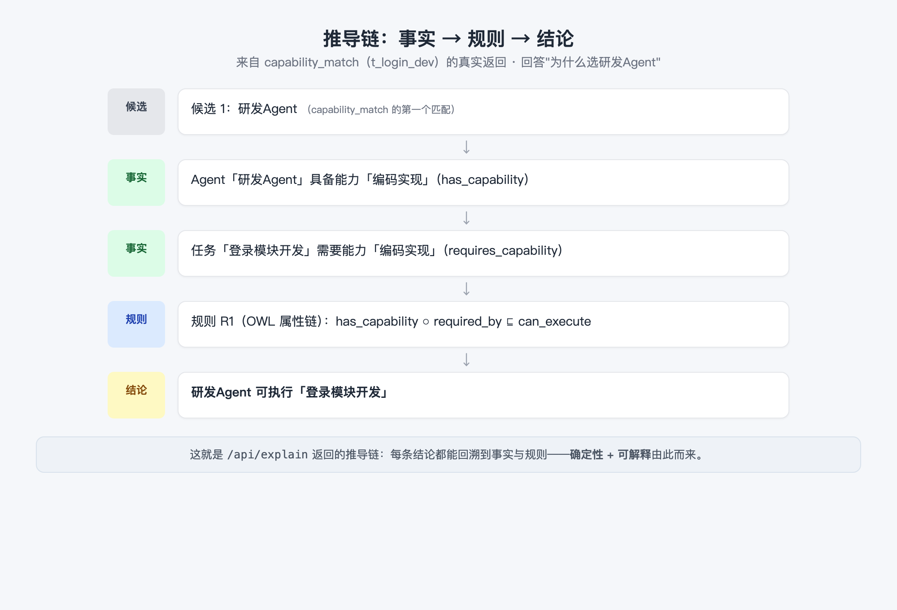

# 03 本体推理原理：从公理到推导链

> 阅读时长：约 15 分钟 · 配套动手：约 8 分钟
> **读完你能**：说清"机器如何从显式知识推出隐式知识"，理解 R1–R4 各自由谁实现，并能读懂推导链

---

## 推理的本质：从显式推出隐式

篇 2 留下一个悬念：`can_execute`（可执行）在 `.owl` 文件里一条都没有，Demo 却能回答"谁能做"。我们来实测一下（在 Docker 容器内跑推理引擎，推理前后各数一次）：

```text
# 推理前：数 .owl 原始文件里的 can_execute 三元组
can_execute 三元组: 0
# 推理后：跑一遍 OWL 2 RL 再数
can_execute 三元组: 8
```

推理器自动产出了 8 条结论，例如：

- `dev_agent → t_login_dev`（研发Agent 可执行 登录模块开发）
- `junior_dev → t_login_dev`（初级研发Agent 也能做——它有编码能力）
- `test_agent → t_login_test`（测试Agent 可执行 测试任务）
- `junior_dev → t_compliance_dev`（初级研发Agent 可执行 敏感数据报表开发——但它没合规认证，会不会有问题？篇 2 提到过，R4 会拦截）

**这就是推理的本质：用规则把"显式知识"（写在文件里的事实）变成"隐式知识"（没写但必然成立的结论）。** 本体不只存数据，还"想"数据。

## OWL 三大常见公理

推理靠的是本体里的**公理（Axiom）**。本项目用到三类，正好对应三种"想"的方式：

| 公理 | 形式 | 作用 | 示例本体里的用法 |
|---|---|---|---|
| **子类** | `A ⊑ B` | 继承：A 的一切性质 B 也有 | `JuniorDevAgent ⊑ DevAgent ⊑ Agent` |
| **传递属性** | `TransitiveProperty(p)` | 关系可跨步传递：A→B 且 B→C，则 A→C | `depends_on`（任务依赖链） |
| **属性链** | `p1 ◦ p2 ⊑ p3` | 两条关系首尾相接，合成一条新关系 | `has_capability ◦ required_by ⊑ can_execute` |

### 属性链：R1 能力匹配

`can_execute` 的属性链公理在 `.owl` 里的真实声明是：

```xml
<owl:ObjectProperty rdf:about="#can_execute">
  <rdfs:domain rdf:resource="#Agent"/>
  <rdfs:range rdf:resource="#Task"/>
  <owl:propertyChainAxiom>
    <rdf:first rdf:resource="#has_capability"/>
    <rdf:first rdf:resource="#required_by"/>
  </owl:propertyChainAxiom>
</owl:ObjectProperty>
```

（`rdf:first/rdf:rest` 只是 XML 里表达"链"的标准写法，等价于：`has_capability ◦ required_by ⊑ can_execute`。）

**这段 XML 逐行读**（读者第一次见公理，别被吓到——每一行都只是"声明一句话"）：

| XML 写法 | 含义 |
|---|---|
| `<owl:ObjectProperty rdf:about="#can_execute">` | 声明 `can_execute` 是一个**对象属性**（连接两个个体的关系，篇 1 的三元组谓语） |
| `<rdfs:domain rdf:resource="#Agent"/>` | 限制：这个属性的**主语必须是 Agent 类** |
| `<rdfs:range rdf:resource="#Task"/>` | 限制：这个属性的**宾语必须是 Task 类** |
| `<owl:propertyChainAxiom> ... </owl:propertyChainAxiom>` | 声明一条**属性链规则**：链上的关系首尾相接，合成新关系 |
| `<rdf:first rdf:resource="#has_capability"/>` 等两个 `rdf:first` | 列出链上的环节：先是 `has_capability`，再是 `required_by` |

合起来就是：`can_execute = has_capability ◦ required_by`（"谁具备能力"接上"能力被谁需要"）。

它说的其实是常识：**"A 具备能力 C" 且 "任务 T 需要能力 C" ⇒ "A 能执行任务 T"。** 只不过这里多了一步——任务需要能力用的是 `requires_capability`，而属性链里用的是它的**逆属性 `required_by`**（"能力被任务需要"，两者互为 `owl:inverseOf`）：

```xml
<owl:ObjectProperty rdf:about="#requires_capability">
  <owl:inverseOf rdf:resource="#required_by"/>
</owl:ObjectProperty>
```

`owl:inverseOf` 只有一句话：声明两个属性**互为逆方向**——`requires_capability`（任务需要能力）和 `required_by`（能力被任务需要）说的是同一件事，只是主语、宾语调了个头。属性链要求环节的"出口宾语"接上下一环节的"入口主语"，所以这里必须用逆属性把方向转过来。

于是链条变成：`has_capability ◦ required_by` ——"A 具备 C，C 被 T 需要"，首尾相接，合成 `can_execute`：



### 传递属性：R3 依赖传递

再看 `depends_on` 的真实声明：

```xml
<owl:ObjectProperty rdf:about="#depends_on">
  <rdf:type rdf:resource="http://www.w3.org/2002/07/owl#TransitiveProperty"/>
  <rdfs:domain rdf:resource="#Task"/>
  <rdfs:range rdf:resource="#Task"/>
</owl:ObjectProperty>
```

与属性链不同，这里只有一个新写法：`rdf:type rdf:resource="...#TransitiveProperty"`——给属性 `depends_on` **打一个"传递属性"的标签**（`rdf:type` 还是篇 1 的"是一个"，只不过这次给属性打标签，不是给个体）。domain/range 限定它只能连接任务与任务。

`TransitiveProperty`（传递属性）让依赖自动"跨步"：`t_login_dev` 依赖 `t_req`、`t_login_review` 依赖 `t_login_dev`，于是推理器自动得出 `t_login_review` **间接依赖** `t_req`。整条"需求分析 → 开发 → 审查 → 测试 → 部署"链，就是一个传递闭包——编排（orchestrate）靠它把复合任务按依赖顺序排好。

## 为什么 R2、R4 必须写代码

属性链、传递、子类都进了本体公理，由推理器统一处理。但并非所有规则都能用 OWL 表达，看两条：

| 规则 | 内容 | 为什么必须写代码 |
|---|---|---|
| **R2 复合任务委派** | Agent 可执行复合任务的全部子任务 ⇒ 可执行复合任务 | 需要"遍历全部子任务再逐一判断"，是聚合逻辑，OWL 公理表达不了 |
| **R4 合规冲突** | 任务要求合规认证、Agent 未认证 ⇒ 冲突报告 | 是"状态判断 + 输出冲突报告"，涉及业务口径，不属于知识推理 |

实测 R4（把合规任务分给没认证的初级研发Agent，在容器内执行 CLI）：

```bash
# 需先启动服务：docker compose up -d api（见篇 0 或本篇「动手」）
docker compose exec api python scripts/query.py assign \
  --task t_compliance_dev --agent junior_dev --pretty
```

```json
{
  "task": "t_compliance_dev",
  "task_label": "敏感数据报表开发",
  "agent": "junior_dev",
  "agent_label": "初级研发Agent",
  "assigned": true,
  "conflict": {
    "type": "合规认证冲突",
    "message": "任务「敏感数据报表开发」要求合规认证，但 Agent「初级研发Agent」未通过认证（has_certified=false）",
    "violated_axiom": "任务 requires_constraint ComplianceRequirement ∧ Agent has_certified=false 不允许分配",
    "rule": "R4"
  }
}
```

所以本项目的分工原则是（这是整个架构最关键的设计）：

> **能进本体的进本体**（属性链、传递、子类 → owlrl 自动推理）；**需要遍历/状态判断的进代码**（聚合、冲突检测 → 领域适配器）。领域查询只消费"推理后的图"，不重复实现 OWL 语义。

| 规则 | 内容 | 实现层 |
|---|---|---|
| R1 | `has_capability ◦ required_by ⊑ can_execute`（属性链） | 本体 .owl → owlrl |
| R2 | 复合任务委派（可执行全部子任务 ⇒ 可执行复合任务） | 适配器代码 |
| R3 | `depends_on` 传递闭包 | 本体 .owl → owlrl |
| R4 | 合规冲突检测 | 适配器代码 |

## 推理器选型：HermiT vs OWL 2 RL

"谁来执行推理"有两个主流选择：

| | HermiT | OWL 2 RL（owlrl） |
|---|---|---|
| 类型 | 完备推理器（DL 推理） | 规则子集推理（RL Profile） |
| 依赖 | 需要 Java Runtime | **纯 Python，零依赖** |
| 场景 | Protege 桌面校验、研究 | 服务内嵌、随处可跑 |

本项目为保证"零依赖随处可跑"，推理层选用**纯 Python 的 owlrl**；本体仍是标准 OWL 2 文件，你可以随时在 Protege（配 Java）里打开它跑 HermiT 校验——**同一份文件，两种推理器都认**。

实测推理统计（`infer` 命令）：

```json
{ "triples_before": 775, "triples_after": 824, "added": 49, "classes": 29, "individuals": 13 }
```

一次推理新增 49 条三元组——绝大多数是 `can_execute` 和传递闭包，全部是"没写出来但必然成立"的知识。

## 推导链：把"为什么"讲给人听

推理得出结果只是第一步，还要能回答"**为什么是它**"。每次查询都附带一条推导链：



这是 `capability_match --task t_login_dev` 的真实返回（`--pretty` 格式化后；完整输出含候选 1、候选 2 两段推导链，此处节选候选 1）：

```json
{
  "task_label": "登录模块开发",
  "matches": [
    { "agent": "dev_agent", "agent_label": "研发Agent", "certified": true, "rule": "R1" },
    { "agent": "junior_dev", "agent_label": "初级研发Agent", "certified": false, "rule": "R1" }
  ],
  "derivation": [
    { "kind": "section", "content": "候选 1：研发Agent" },
    { "kind": "fact", "content": "Agent「研发Agent」具备能力「编码实现」（has_capability）" },
    { "kind": "fact", "content": "任务「登录模块开发」需要能力「编码实现」（requires_capability）" },
    { "kind": "rule", "content": "规则 R1（OWL 属性链）：has_capability ◦ required_by ⊑ can_execute" },
    { "kind": "conclusion", "content": "结论：研发Agent 可执行「登录模块开发」" }
  ]
}
```

结构永远是 **候选 → 事实 → 事实 → 规则 → 结论**。推导链不是装饰——它让每个结论都可回溯、可审计，这正是本体相对大模型的核心优势（篇 0 的三痛点之二）。

## 动手：跑一遍推理

所有命令都在 Docker 容器内执行（依赖已内置，无需宿主机装 Python 环境；篇 5 会完整介绍服务的容器化用法）：

**方式一：HTTP API（Docker 启动服务）**

```bash
cd ontology-agent-demo
docker compose up -d api     # 后台启动推理 API（:8000，容器内）

# R1 能力匹配（返回 matches + derivation）
curl -s -X POST http://127.0.0.1:8000/api/reason \
  -H "Content-Type: application/json" -d '{"type":"capability_match","task":"t_login_dev"}'
```

**方式二：CLI（在容器内执行，连容器内服务）**

```bash
docker compose exec api python scripts/query.py capability_match --task t_login_dev --pretty   # R1 能力匹配
docker compose exec api python scripts/query.py orchestrate --task t_feature --pretty          # R3 编排（依赖拓扑）
docker compose exec api python scripts/query.py assign --task t_compliance_dev --agent junior_dev --pretty  # R4 冲突
docker compose exec api python scripts/query.py explain --pretty                               # 最近一次推导链
docker compose exec api python scripts/query.py infer --pretty                                 # 推理统计
```

> CLI 在容器内默认走 HTTP（连同一容器内的推理 API，`http://127.0.0.1:8000`）；机制上还支持 `--local` 走内嵌引擎（不依赖服务），但需宿主机安装 `owlrl`/`rdflib`，本系列一律以容器方式为准。`scripts/query.py` 是 `ontology-reasoning` Skill 的 CLI，更多用法见篇 5。

## 小结

1. **推理 = 用公理从显式知识推出隐式知识**：`can_execute` 实测 0 → 8 条。
2. **三种公理三种"想"法**：子类（继承）、传递属性（跨步）、属性链（首尾相接合成新关系）。
3. **R1/R3 进本体，R2/R4 进代码**——能表达的交给推理器，不能表达的（聚合/状态判断）写适配器。
4. **推导链 = 事实 → 规则 → 结论**，让每条结论可回溯、可解释。

**常见问题**

- **Q：为什么推理后 `can_execute` 恰好 8 条？**
  A：8 条来自"具备该能力的 Agent × 需要该能力的任务"的匹配组合（如编码能力连接了 dev_agent/junior_dev 与 t_login_dev/t_compliance_dev）。你可以用 `docker compose exec api python scripts/query.py types --individual dev_agent --pretty` 验证任意个体推理后的类型。
- **Q：HermiT 和 owlrl 结果会不一样吗？**
  A：对本体的 RL 可表达部分结果一致；HermiT 还能处理更复杂的 DL 公理。本项目用的公理都在 RL 范围内，两种推理器结论一致。

## 附录：本文用到的 OWL 语法

本文出现了三类"公理"写法。其中 `owl:Class`、`rdfs:subClassOf`、`rdfs:label`、`rdf:about/rdf:resource` 已在篇 1 学过（下表标 ★）；以下为本文新增语法，集中说明：

| 语法 | 作用 | 例子 | 对应三元组 / 数学记法 |
|---|---|---|---|
| `<owl:ObjectProperty rdf:about="#p">` | 声明 `p` 是一个对象属性（连接两个个体） | `#can_execute`、`#depends_on` | `p rdf:type owl:ObjectProperty` |
| `<rdfs:domain rdf:resource="#A"/>` | 限制 `p` 的主语必须是类 A | `#Agent`、`#Task` | `p rdfs:domain A` |
| `<rdfs:range rdf:resource="#B"/>` | 限制 `p` 的宾语必须是类 B | `#Task` | `p rdfs:range B` |
| `<owl:propertyChainAxiom>` + `<rdf:first .../>` | 属性链：环节首尾相接合成新关系 | `has_capability → required_by ⇒ can_execute` | `has_capability ◦ required_by ⊑ can_execute` |
| `<owl:inverseOf rdf:resource="#q"/>` | 声明 `p` 与 `q` 互为逆属性 | `requires_capability ↔ required_by` | `p owl:inverseOf q` |
| `rdf:type rdf:resource="...#TransitiveProperty"` | 给 `p` 打"传递属性"标签 | `depends_on` | `p rdf:type owl:TransitiveProperty` |

> 记忆口诀：**`domain/range` 管"谁能连谁"，`inverseOf` 管"换个方向也能说"，`TransitiveProperty` 管"能跨步"，`propertyChainAxiom` 管"两步并一步"。** 下一篇用 SPARQL 直接"问"这张图。

---
**下一篇**：篇 4《本体与知识图谱：一张图看懂》——理清"本体"与"图数据库"这两个总被混为一谈的概念。
