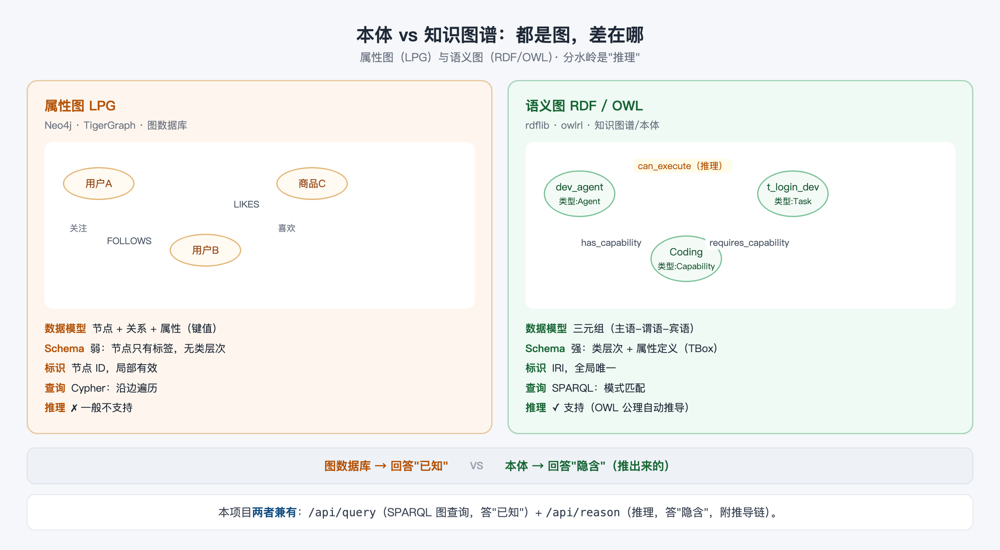

# 04 本体与知识图谱：一张图看懂

> 阅读时长：约 10 分钟 · 配套动手：约 5 分钟
> **读完你能**：向别人讲清"本体"和"图数据库"的区别，并知道什么场景该选谁

---

## 都是"图"，差在哪

"本体"和"知识图谱"常被混为一谈——因为它们确实长得很像：**都存"实体 + 关系"，都可以画成一张点线图**。但它们的底层哲学完全不同：



左边是**属性图（LPG）**——图数据库（Neo4j、TigerGraph）的模型：节点带标签和属性，边带关系名，查询靠沿边遍历。右边是**语义图（RDF/OWL）**——知识图谱、本体的模型：一切知识都是三元组，节点和边都有**类型定义**，还能推理。

## 三元组 → RDF 图 → SPARQL

篇 1 学的三元组，把若干个拼在一起，就是一个 **RDF 图**：主语和宾语是节点，谓语是边。

```
dev_agent --has_capability--> Coding
t_login_dev --requires_capability--> Coding
dev_agent --can_execute--> t_login_dev   ← 推理产生的边
```

查询这种图的语言叫 **SPARQL**——用"模式"去匹配图中的三元组。本项目通用查询接口就是它，实测：

```bash
curl -s -X POST http://127.0.0.1:8000/api/query \
  -H "Content-Type: application/json" \
  -d '{"sparql":"SELECT ?i WHERE { ?i a <http://demo.example.org/agent-task-ontology#Agent> }"}'
```

```json
{ "results": [ { "i": "junior_dev" }, { "i": "dev_agent" },
               { "i": "deploy_agent" }, { "i": "req_agent" }, { "i": "test_agent" } ] }
```

一句话 `SELECT ?i WHERE { ?i a ...Agent }`（"谁是智能体？"）就匹配出全部 5 个 Agent，IRI 自动转成短名。这就是"图查询"：**回答已知的事实**。

## 属性图 vs 语义图：五维对比

| 维度 | 属性图（LPG） | 语义图（RDF/OWL） |
|---|---|---|
| 数据模型 | 节点 + 关系 + 属性（键值对） | 三元组（主语-谓语-宾语） |
| Schema | 弱：节点只有标签，没有类层次 | 强：类层次 + 属性定义（TBox） |
| 标识 | 节点 ID，局部有效 | **IRI，全局唯一**（可跨系统共享） |
| 查询 | Cypher：沿边遍历 | SPARQL：模式匹配 |
| 推理 | ✗ 一般不支持 | ✓ OWL 公理自动推导 |

两个关键差异值得展开：

1. **Schema 强弱**：属性图里的"用户""商品"只是标签，标签之间没有继承、没有约束；语义图里 `DevAgent ⊑ Agent` 是**类型系统**——这正是篇 3 推理能"举一反三"的前提。
2. **IRI 全局唯一**：`http://demo.example.org/agent-task-ontology#dev_agent` 这个 ID 在任何系统里都指向同一个东西，所以本体可以跨组织共享、合并——"共享概念模型"靠的就是这个。

## 分水岭：已知 vs 隐含

这是全篇最重要的一句话：

> **图数据库回答"已知"，本体回答"隐含"。**

用数据说话。在原始 `.owl` 里，`can_execute` 一条都没有（篇 3 实测：0 条）。问图数据库"谁能执行登录模块开发"，它答不上来——**这条关系根本没存**。但本体推过之后，你能查到：

```bash
curl -s -X POST http://127.0.0.1:8000/api/query \
  -H "Content-Type: application/json" \
  -d '{"sparql":"SELECT ?a ?t WHERE { ?a <http://demo.example.org/agent-task-ontology#can_execute> ?t }"}'
```

```json
{ "results": [
    { "a": "dev_agent",   "t": "t_login_dev" },
    { "a": "junior_dev",  "t": "t_login_dev" },
    { "a": "test_agent",  "t": "t_login_test" },
    { "a": "deploy_agent","t": "t_deploy" },
    ...
] }
```

注意：这条 SPARQL 能查到 8 条，是因为**引擎在查询前先执行了推理**（把隐含知识"物化"进图里）。纯图数据库没有推理器，同样的图永远查不出这条边。

## 本项目两者兼有

所以本服务其实是一个"合体"：

| 能力 | 接口 | 回答什么 |
|---|---|---|
| **图查询** | `/api/query`（SPARQL）、`/api/individuals`、`/api/classes` 等 | 已知：图里有什么 |
| **推理** | `/api/reason`（能力匹配/编排/分配）、`/api/consistency` | 隐含：能推出什么 + 为什么 |

流程是：**加载 .owl → 推理器把隐含知识补全 → 图查询与业务查询都消费这张"推理后的图"**。图查询给你灵活性，推理给你确定性与可解释，两者互补而非对立。

## 选型建议

| 你的场景 | 选谁 |
|---|---|
| 社交网络、实时推荐、路径遍历——关系**已经存在**，要高效查询 | 图数据库（Neo4j 等） |
| 需要**自动推导**新关系、结论可解释、schema 跨系统共享 | 本体 + 推理（本项目） |
| 又要高效遍历、又要确定性推导 | 混合：图库存数据 + 本体做推理层（本项目是轻量示范） |

一个简单的判断标准：**如果你要的答案"已经有人/系统明确写进数据里了"，图数据库够用；如果答案要靠规则"推"出来，你需要本体。**

## 小结

1. 属性图与语义图都存"实体+关系"，但**schema 强弱、标识机制、查询语言**不同。
2. **分水岭是推理**：图数据库答"已知"，本体答"隐含"。
3. 本项目 = 图查询（`/api/query`）+ 推理（`/api/reason`）的合体：先推理成图，再图查询。

**常见问题**

- **Q：知识图谱和本体到底是不是一回事？**
  A：日常用语里常混用。严格讲：**知识图谱 = 数据**（以 ABox 事实为主，如"dev_agent 具备 Coding"），**本体 = schema + 规则**（TBox，如类层次与属性链）；两者结合才是完整的语义图。本项目 `.owl` 文件把两者都装进去了。
- **Q：为什么不用 Neo4j 而要自己搭推理？**
  A：Neo4j 是图数据库，不内置 OWL 推理。要推理就得外接规则引擎或用 APOC 等插件手写——这正是本项目用 owlrl 直接解决的问题（篇 5 会看到它有多轻）。

---
**下一篇**：篇 5《半小时搭建本体推理服务》——把前面讲的概念，变成一个你能跑起来、能调用的 REST API + CLI。
