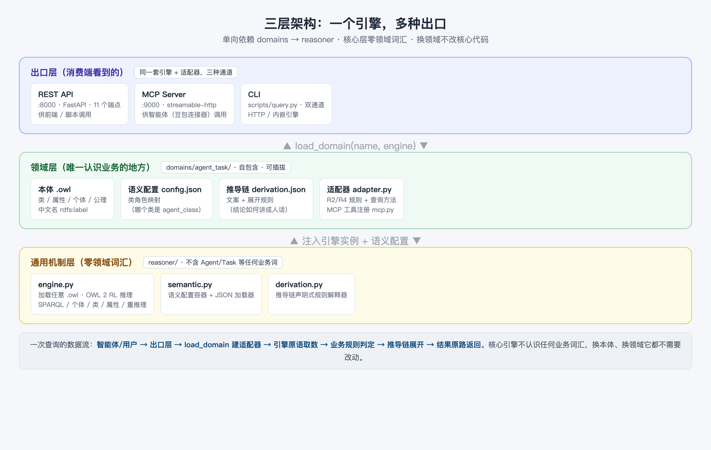

# 05 半小时搭建本体推理服务（REST API + CLI）

> 阅读时长：约 15 分钟 · 配套动手：约 20 分钟
> **读完你能**：独立把推理服务跑起来，并用 curl 和 CLI 两种方式完成查询——这是"应用本体"的第一步

---

## 架构速览：三层，一次看懂

动手之前，先花 3 分钟看懂项目骨架。整个服务分三层，单向依赖：



| 层 | 职责 | 关键点 |
|---|---|---|
| **出口层** | REST API（:8000）、MCP Server（:9000）、CLI | 同一套引擎 + 适配器，三种通道 |
| **领域层** | `domains/agent_task/`：本体 .owl、语义配置、推导链、适配器 | 唯一认识业务的地方，自包含、可插拔 |
| **通用机制层** | `reasoner/`：engine.py、semantic.py、derivation.py | **零领域词汇**：不含 Agent、Task 等任何业务词 |

两个贯穿全文的设计理念：

1. **核心层零领域词汇**：引擎只回答"图里有什么、能推出什么"，不认识任何业务。所以换本体、换领域，核心代码不用改（篇 8 会实操）。
2. **领域包自包含**：一个领域 = 本体 + 数据 + 逻辑，放一个目录里，运行时动态加载。

## 第 1 步：环境准备（Docker）

不需要在宿主机安装任何 Python 依赖——容器镜像已内置全部依赖（rdflib / owlrl / fastapi / uvicorn / mcp）：

```bash
cd ontology-agent-demo
docker compose up -d api     # 首次自动构建镜像（稍等片刻），之后秒级启动
```

## 第 2 步：启动服务

`docker compose up -d api` 已把推理 API 起在容器内（`0.0.0.0:8000`），宿主机通过端口映射访问：

```bash
docker compose up -d api     # 若上一步已启动可跳过
```

浏览器打开 **http://127.0.0.1:8000** 即 Demo 图谱页。验证服务状态：

```bash
curl -s http://127.0.0.1:8000/api/health
```

```json
{"status":"ok","ontology":"agent_task_ontology.owl",
 "reasoner":"OWL 2 RL (owlrl) + 业务规则 R2/R4",
 "domain":"agent_task","agents":5,"tasks":8,"assignments":0}
```

一眼看清：加载的本体、使用的推理器、当前领域、Agent/Task 数量。

## 第 3 步：认识 11 个端点

服务共 11 个 API 端点（另有 `/` Demo 页与 `/api/health`），分两类：

**领域端点（走适配器，绑定当前领域语义）**

| 方法 | 路径 | 请求 | 功能 |
|---|---|---|---|
| GET | `/api/ontology` | — | 图谱数据（类/个体/边） |
| POST | `/api/reason` | `{type: capability_match\|orchestrate\|assign, task, agent?}` | 领域查询（匹配/编排/分配） |
| POST | `/api/classify` | `{name, capabilities, constraints, risk_level?}` | 新增个体并自动分类 |
| POST | `/api/explain` | — | 最近一次推理的推导链 |
| POST | `/api/consistency` | — | 一致性 / 合规冲突检查 |

**通用端点（走引擎，与本体无关，任意 .owl 可用）**

| 方法 | 路径 | 请求 | 功能 |
|---|---|---|---|
| POST | `/api/query` | `{sparql}` | SPARQL SELECT（IRI 转短名） |
| POST | `/api/individuals` | `{class_name}` | 类（含子类）的个体列表 |
| POST | `/api/classes` | — | 全部类层次（name/label/parent） |
| POST | `/api/types` | `{individual}` | 个体推理后的全部类型 |
| POST | `/api/property` | `{subject, property}` | 主体-属性取值列表 |
| POST | `/api/infer` | — | 重新推理，返回三元组统计 |

记住一个口诀：**领域端点回答"业务问题"（谁能做/怎么排/合不合规），通用端点回答"图里有什么"（查询/枚举/统计）**。

## 第 4 步：curl 实操 3 例

**例 1：能力匹配（业务问题）**

```bash
curl -s -X POST http://127.0.0.1:8000/api/reason \
  -H "Content-Type: application/json" \
  -d '{"type":"capability_match","task":"t_login_dev"}'
```

```json
{"task":"t_login_dev","task_label":"登录模块开发","task_type":"简单任务",
 "matches":[
   {"agent":"dev_agent","agent_label":"研发Agent","certified":true,"rule":"R1"},
   {"agent":"junior_dev","agent_label":"初级研发Agent","certified":false,"rule":"R1"}
 ],
 "derivation":[
   {"kind":"section","content":"候选 1：研发Agent"},
   {"kind":"fact","content":"Agent「研发Agent」具备能力「编码实现」（has_capability）"},
   {"kind":"rule","content":"规则 R1（OWL 属性链）：has_capability ◦ required_by ⊑ can_execute"},
   {"kind":"conclusion","content":"结论：研发Agent 可执行「登录模块开发」"}
 ]}
```

**例 2：SPARQL 图查询（通用问题）**

```bash
curl -s -X POST http://127.0.0.1:8000/api/query \
  -H "Content-Type: application/json" \
  -d '{"sparql":"SELECT ?i WHERE { ?i a <http://demo.example.org/agent-task-ontology#Agent> }"}'
```

```json
{"results":[{"i":"junior_dev"},{"i":"dev_agent"},{"i":"deploy_agent"},{"i":"req_agent"},{"i":"test_agent"}]}
```

**例 3：枚举个体**

```bash
curl -s -X POST http://127.0.0.1:8000/api/individuals \
  -H "Content-Type: application/json" -d '{"class_name":"Task"}'
```

```json
{"class":"Task","individuals":["t_compliance_dev","t_deploy","t_double_dev","t_feature","t_login_dev","t_login_review","t_login_test","t_req"]}
```

## 第 5 步：CLI 双通道与 ontology-reasoning Skill

除了 REST API，项目同源封装了 **`ontology-reasoning` Skill** 的 CLI，统一入口 `scripts/query.py`（已随镜像打进容器），输出 JSON（`--pretty` 美化）。它最实用的设计是**双通道**：

- **默认**：先走 HTTP API（即容器内 `http://127.0.0.1:8000` 的服务）；服务没启动时**自动回退内嵌引擎**（自带引擎 + 本体副本，零服务依赖也能跑）；
- `--http`：强制 HTTP（服务不在时报错）；
- `--local`：强制内嵌引擎（不依赖服务，结果与 HTTP 一致）；
- 环境变量 `DOUBAO_API_BASE`：覆盖 API 地址（默认 `http://127.0.0.1:8000`，容器内无需改动）。

```bash
# Docker 模式下在容器内执行（无需在宿主机装任何 Python 依赖）
docker compose exec api python scripts/query.py capability_match --task t_login_dev --pretty
docker compose exec api python scripts/query.py orchestrate --task t_feature --pretty
docker compose exec api python scripts/query.py consistency --pretty
```

> 机制上 `--local` 支持宿主机内嵌引擎，但那需要宿主机另装 `owlrl`、`rdflib`；本系列一律以容器内执行为准（纯 HTTP 通道在容器内只用标准库即可）。

子命令分两组，与 API 端点一一对应：

**领域子命令（7 个）**

| 子命令 | 参数 | 对应能力 |
|---|---|---|
| `capability_match` | `--task` | R1/R2：可执行者匹配（附推导链） |
| `orchestrate` | `--task` | 复合任务拆解 + 依赖拓扑 + 逐环节匹配 |
| `assign` | `--task --agent` | 分配 + R4 合规冲突检测 |
| `classify` | `--name [--capabilities --constraints --risk]` | 新增任务个体、重推理、分类 |
| `consistency` | — | 全量一致性 / 合规冲突检查 |
| `explain` | — | 最近一次推导链 |
| `ontology` | — | 本体结构（图谱渲染数据） |

**通用子命令（6 个，与本体定义无关）**

| 子命令 | 参数 | 说明 |
|---|---|---|
| `query-sparql` | `--sparql` | SPARQL SELECT |
| `individuals` | `--class` | 类下个体列表 |
| `classes` | — | 类层次 |
| `types` | `--individual` | 个体推理后类型 |
| `property` | `--subject --property` | 属性取值 |
| `infer` | — | 重推理 + 统计 |

> Skill 封装的价值：**"接口优先、引擎兜底"**。服务在 Docker 容器里就用 HTTP（多进程共享一个推理引擎），没起服务也能用 `--local` 内嵌跑——同一份命令，两种环境都成立。

## 第 6 步：验证

```bash
docker compose exec api python -m pytest tests/ -q
```

实测结果：**29 passed**，覆盖 R1–R4 推理、推导链结构、全部 API 端点行为。跑通这 29 项，说明你的环境（容器镜像）和代码是健康的，可以放心往下做。

## 小结

1. **三层架构**：出口层（API/MCP/CLI）→ 领域层（本体+数据+逻辑）→ 通用机制层（零词汇引擎），单向依赖。
2. **11 个端点**：5 个领域端点答业务问题，6 个通用端点查图。
3. **CLI 双通道**：容器内执行，默认 HTTP 连容器内服务，`--local` 内嵌备选——同一份命令，两种环境。
4. **测试 29 项全绿** = 服务可复现、可交付。

**常见问题**

- **Q：API 和 CLI 结果会不一致吗？**
  A：不会。两者共享同一套引擎与领域包；CLI 的 HTTP 通道就是调用 API（Docker 容器内服务），`--local` 是同一份代码的内嵌模式，测试保证结果一致。
- **Q：端口被占用怎么办？**
  A：改端口启动即可（如 `docker compose exec api uvicorn api.main:app --port 8001`），CLI 用 `DOUBAO_API_BASE=http://127.0.0.1:8001` 跟随（容器内需同步修改映射端口）。
- **Q：想换一个本体跑？**
  A：通用查询（individuals/classes/SPARQL…）对任意 .owl 直接可用；领域查询要换领域包——篇 8 专门讲。

---
**下一篇**：篇 6《用 MCP 把本体服务接入智能体》——让豆包在对话里直接调用这 14 个工具。
