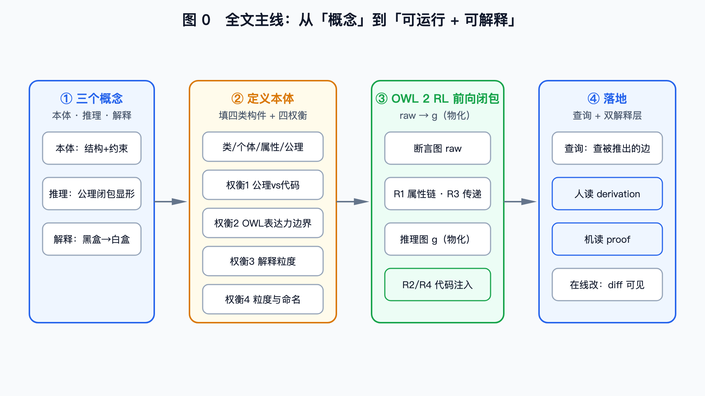
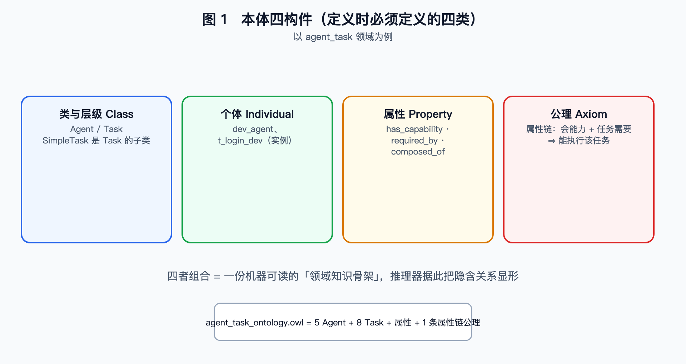
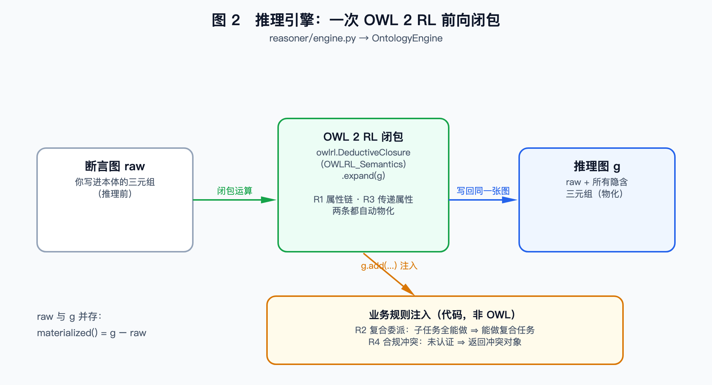
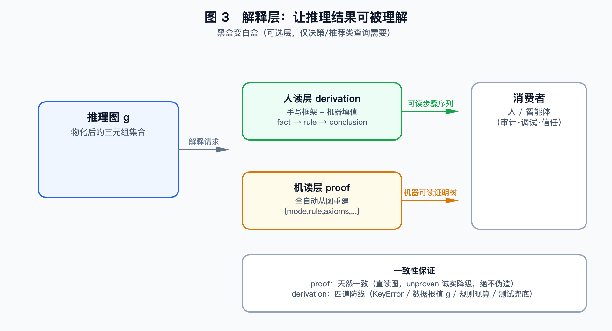

# 05 本体、推理与解释：从概念到真实可跑

完整系列文章与全部源码都在 GitHub：**https://github.com/jasony62/ontology-agent-demo**（欢迎 Star / Fork / Issue）

你问一个智能体"登录模块这活儿谁能干？"，它答得又快又准——可你翻遍系统，**从没在任何地方告诉过它这个答案**。秘密在"本体"：一份"这个领域有哪些角色、遵守哪些常识规则"的机器可读说明书。本文不绕弯子，直接用本项目 `agent_task`（智能体任务编排）领域的**真实数据**，讲清四件事——本体、推理、解释，以及定义本体时人必须做的权衡。硬核概念一个不省，但每条都配一个"真实跑通"的例子。



## 一、三个概念

### 1.1 本体：领域知识的骨架

本体是对"领域里有什么、什么关系、遵守什么规则"的**机器可读描述**。它**不是数据库（存数据），而是一套结构 + 约束**——教推理器"这个领域怎么想"。

本项目的 `agent_task_ontology.owl` 就是一份真实本体，四类构件俱全：

| 构件 | 是什么 | 本项目实例 |
|---|---|---|
| **类与层级** | 概念及其继承 | `Agent`、`Task`；`SimpleTask` 是 `Task` 的子类、`ComplexTask` 也是、`CertifiedAgent` 是 `Agent` 的子类 |
| **个体** | 类的具体实例 | `dev_agent`（研发Agent）、`junior_dev`（初级研发Agent）、`t_login_dev`（登录开发）、`t_compliance_dev`（敏感数据报表开发） |
| **属性** | 个体间/个体与值的关系 | 对象属性 `has_capability`（会什么能力）、`requires_capability`（任务要什么能力）、`composed_of`（由哪些子任务组成）；数据属性 `has_certified`（是否持证）、`has_risk_level`（风险等级） |
| **公理** | 关于类/属性的规则 | 属性链 `has_capability ∘ required_by ⊑ can_execute`（会能力、且任务需要该能力 ⇒ 能执行）；逆属性 `requires_capability` 的逆是 `required_by`；子类 `SimpleTask ⊑ Task` |

> 记号说明：`⊑` 读作"是……的子类"，`∘` 读作"属性链复合"（A 经第一个关系、再经第二个关系，可推出第三个关系）。

**本体定义检查表**
1. ☐ 类与分类层级（谁是谁的子类？）
2. ☐ 个体及其类型
3. ☐ 对象属性 + 数据属性（定义域/值域）
4. ☐ 公理（属性链 / 逆属性 / 传递性 / 等价·子类 / 组合语义）

> 定义一份本体，你要定义的就这四类。这张表就是你的"定义检查表"。



### 1.2 推理：OWL 2 RL 前向闭包与"物化"

**推理 = 从"你写下的断言 + 公理"，推出所有"逻辑上必然成立、你却没手写"的隐含知识。**

看本项目本体里的真实数据。你只写了两条事实：
- `dev_agent` 会 `Coding`（has_capability）
- `t_login_dev` 需要 `Coding`（requires_capability）

你**从没写**"dev_agent 能做 t_login_dev"。但推理引擎加载时跑一次闭包，图里**自动多出这条边**：`dev_agent` 能执行 `t_login_dev`（can_execute）。

机制：把公理当规则，在图上**反复套用直到没有新结论**（前向闭包 / forward closure），把隐含三元组一次性算齐、写回图里——**这一步就叫"物化"（materialize）**。物化之后，查询"谁能做某任务"只是查一张**已经算好的图**，不必每次现推。

本项目仅这一条属性链，就从断言里额外推出 **8 条 `can_execute`**：

```
req_agent    → t_req             dev_agent    → t_login_review
dev_agent    → t_login_dev       test_agent   → t_login_test
junior_dev   → t_login_dev       deploy_agent → t_deploy
dev_agent    → t_compliance_dev  junior_dev   → t_compliance_dev
```

同一次闭包里，还跑着**第二条** RL 原生规则：**传递属性**。本体只写一行，把 `depends_on` 声明成"可传递"：

```
:depends_on  a  owl:TransitiveProperty .     # 依赖关系可以跨级传递
```

于是你只写了 **4 条直接依赖**（正好一条任务链）：

```
t_login_dev    依赖 t_req            t_login_test   依赖 t_login_review
t_login_review 依赖 t_login_dev      t_deploy       依赖 t_login_test
```

闭包后图里变成 **10 条** `depends_on`——多出的 6 条全是跨级间接依赖：`t_login_review` 也依赖 `t_req`、`t_deploy` 也依赖 `t_req`……**"这件事到底卡在哪些前置上"，从"递归查"降成"一次直查"**。这条摊平后的依赖链，就是 §3.2"编排"排序的依据。

> OWL 2 RL 里最值钱的就是这两类规则：**属性链**把组合关系连起来（R1），**传递属性**把传递关系摊平（R3）。各一行公理，换掉两段递归代码。

#### 为什么是 OWL 2 RL，而不是 OWL 2 DL？

OWL 2 有几个"推理配置文件"（profile），表达力与可计算性此消彼长：

| | **OWL 2 DL**（描述逻辑，全集） | **OWL 2 RL**（规则子集） |
|---|---|---|
| 表达力 | 强：复杂约束、基数、否定、组合都能写 | 弱：受限于可"规则化"的形式 |
| 推理方式 | 描述逻辑 tableau / 模型构造 | 基于规则的前向推理（类 Datalog） |
| 复杂度 | 最坏情况很高 | 多项式时间，工程可实现 |
| 能否物化 | 难（多为查询时推理） | **能**：可把闭包结果写回图 |
| 代表工具 | HermiT、Pellet、FaCT++ | `owlrl`（Python） |

**取舍**：本项目选 RL，是因为它能在普通服务里跑、能物化、能对每条边给出解释；代价是表达力受限。像"整体由部分组成、能做全部部分就能做整体"这种组合语义，**DL 里 HermiT 能推，RL 单靠公理推不出来**——所以这类规则下放到代码（见 §二 R2）。一句话：**RL 用表达力换可计算性与工程落地。**



### 1.3 解释：人读 derivation 与机读 proof

推理器只吐结论（"dev_agent 能做 t_login_dev"），**不记录"为什么"**。对可信系统这不够：要**可审计、可调试、可信任**。本项目做了**两层解释**，分别面向人和程序。

**① 人读层 `derivation`——声明式解释器。** 它不是硬编码字符串，而是"规则 + 模板"都存成数据（`derivation.json`）：模板把一句话挖空（如 `"结论：{agent} 可执行「{task}」"`），规则用 `if` / `loop` / `step` 描述怎么展开。`reasoner/derivation.py` 是解释器，按规则遍历、用查询上下文 `ctx` 里的**真实值**填充模板。**人只写叙述骨架和措辞，实值与规则归属由机器从图里取**——改措辞只改 JSON，不碰 Python。

```jsonc
// derivation.json 里 capability_match 的规则骨架（节选）
{ "if": "$matches",
  "then": [ { "loop": "$matches", "var": "m", "steps": [
      { "step": { "kind": "section", "tpl": "candidate", "params": {"i": "$m.i", "agent": "$m.agent_label"} } },
      { "loop": "$m.shared_capability_labels", "var": "cap", "steps": [
          { "step": { "kind": "fact", "tpl": "fact_agent_has_cap", "params": {"agent": "$m.agent_label", "cap": "$cap"} } },
          { "step": { "kind": "fact", "tpl": "fact_task_requires_cap", "params": {"task": "$task_label", "cap": "$cap"} } }
      ] },
      { "step": { "kind": "rule", "tpl": "$m.rule_tmpl" } },
      { "step": { "kind": "conclusion", "tpl": "conclusion_can_execute", "params": {"agent": "$m.agent_label", "task": "$task_label"} } }
  ] } ]
}
```

同一份规则，喂进真实数据后渲染出：

```
候选 1：研发Agent
  · 事实：Agent「研发Agent」具备能力「编码实现」（has_capability）
  · 事实：任务「登录模块开发」需要能力「编码实现」（requires_capability）
  · 规则 R1（OWL 属性链）：has_capability ∘ required_by ⊑ can_execute
  · 结论：研发Agent 可执行「登录模块开发」
```

注意 IRI `Coding` 在这里显示成「编码实现」——**人读文本里每个名字都取自本体的 `rdfs:label`**，代码里没有一个硬编码中文（见权衡四）。同一个 `Coding`，在图里是 IRI，给人看时是"编码实现"。

**② 机读层 `proof`——全自动证明树。** `reasoner/proof.py` 不依赖任何手写模板，直接从 `raw`（断言图）与 `g`（推理图）**反查**这条结论怎么来的，输出结构化证明：

```json
{
  "mode": "derived",
  "rule": "property_chain",
  "axioms": [{"type": "owl:propertyChainAxiom", "chain": ["has_capability", "required_by"]}],
  "premises": [
    {"subject": "dev_agent", "predicate": "has_capability", "object": "Coding",      "source": "asserted"},
    {"subject": "Coding",    "predicate": "required_by",    "object": "t_login_dev", "source": "derived"}
  ],
  "conclusion": {"subject": "dev_agent", "predicate": "can_execute", "object": "t_login_dev"}
}
```

注意 `premises` 第二条 `source: "derived"`——"Coding required_by t_login_dev" 是逆属性推出的，不是直接断言。`mode` 有三态：`asserted`（本来就有）/ `derived`（推出来的，附规则+前提）/ `unproven`（推不出来，**诚实降级，绝不伪造**）。

若结论是 R3 推出来的（如"`t_deploy` 依赖 `t_req`"），`proof` 的 `premises` 给的是**原始 4 条直接依赖边链**、`source` 全为 `asserted`，而不是"闭包结论拿闭包结论作证据"——**证明不循环**。这是可审计的底线：再长的推理链，也必须一步步落回你亲手写下的断言。

| 维度 | 人读 `derivation` | 机读 `proof` |
|---|---|---|
| 面向 | 人（讲得清） | 程序/审计（查得证） |
| 谁写 | 手写框架 + 机器填值 | 全自动，无模板 |
| 一致性 | 靠四道防线兜底 | 天然一致（直读图） |

> 解释是**可选层**，不是本体必需成分，只有"决策/推荐类"判断才需要它。



## 二、重点：人要做哪些权衡

填满检查表只是开始。真正难的是**只有人能做、机器替不了的权衡**——它决定本体好不好维护、推理对不对、解释清不清楚。

### 权衡一：一条关系，写进公理还是留给代码？（R2 实例）

- **写进公理（OWL）**：引擎自动推论。**优**：声明式、换更强推理器结论自动变多；**劣**：某些关系写成公理会让文件随个体数膨胀。
- **留给代码**：加载时算出再补进图。**优**：本体简洁可读；**劣**：要维护代码、proof 覆盖不到。

**真实例子（R2 复合任务委派）**：`t_double_dev` 由"登录开发 + 合规开发"两个子任务组成。若某 Agent 能执行这两个子任务（R1 已推出），按"整体=各部分、能做全部部分⇒能做整体"，它就该能做 `t_double_dev`。这条组合语义 **OWL 2 DL 能表达（HermiT 可物化）**，但写成"每 Agent 一条"组合公理会让本体膨胀、难维护。故本项目**不写进 OWL，由 `_apply_r2()` 在加载时生成**——效果等价，只是边来自代码。

> ⚠️ 常见误解："写在代码里" ≠ "OWL 表达不了"，往往是**为简洁的工程取舍**。

### 权衡二：四条规则各答一个问题，哪些交引擎、哪些自己写？（R1 / R2 / R3 / R4）

本项目一共四条规则。它们不是随手编号的，而是回答**四个不同的问题**——这也是定义本体时最容易漏的一步：先把"我要系统替我回答哪些问题"列出来，再逐条决定规则落在公理里还是代码里。

| 规则 | 回答什么问题 | 规则内容 | 落点 | 为什么放这儿 |
|---|---|---|---|---|
| **R1** | 谁**能做**？ | 会能力 X 且任务需要 X ⇒ 能执行该任务（`has_capability ∘ required_by ⊑ can_execute`） | OWL 属性链 | RL 原生支持，自动物化 |
| **R3** | 按**什么顺序**做？ | 依赖可传递 ⇒ 把直接依赖摊平成全序 | OWL 传递属性 | RL 原生支持，自动物化 |
| **R2** | 能不能**整体认领**？ | 能做全部子任务 ⇒ 能做复合任务 | 代码 `_apply_r2()` | DL 能表达、RL 推不出；写成公理会膨胀 |
| **R4** | 合规上**许不许**做？ | 任务要求认证、Agent 未认证 ⇒ 冲突 | 代码 `_compliance_conflict()` | **运行时校验**，返回冲突而非推新边 |

规律很清楚：**R1、R3 一行公理就拿走（在 RL 的规则集里有现成形式），R2、R4 必须写代码**（RL 推不出 / 运行时校验而非推边）。所以"哪些交引擎、哪些人来写"不是凭感觉——**去看 RL 规则集里有没有对应形式；有就写公理，没有才下放代码。**

**R4 真实例子**：`t_compliance_dev`（敏感数据报表开发）带约束 `requires_constraint ComplianceRequirement`。`dev_agent` 与 `junior_dev` 都能执行它（R1 都推出 `can_execute`），但 `junior_dev` 的 `has_certified=false`。于是把 `t_compliance_dev` 分给 `junior_dev` 触发 R4 冲突：

```json
{"type":"合规认证冲突","rule":"R4",
 "message":"任务「敏感数据报表开发」要求合规认证，但 Agent「初级研发Agent」未通过认证（has_certified=false）"}
```

而 `dev_agent` 持证（`has_certified=true`），通过。**这正是 R1 与 R4 的分工：R1 判"能力上能不能做"，R4 判"合规上许不许做"——两层不同，不能混为一谈。**

### 权衡三：解释写到多细？

- 非显然结论/决策（能力匹配、分配）→ **需要**解释；
- 纯原始数据检索（直查关系网）→ 结论即数据，**不需要**；
- 要可审计上 `proof`，要人读懂上 `derivation`，两者可只取其一。

### 权衡四：粒度与命名

- **粒度**：拆多细？太细→维护爆炸；太粗→推不出结论（不分 `SimpleTask`/`ComplexTask`，R2 就触发不了）。
- **标签单一事实源**：中文名**只来自本体自带的 `rdfs:label`**，绝不在代码写死中文——否则对不上，是经典坑。

> **一句话**：定义本体 = 填检查表（§1）+ 在四个岔路口做人工决策。**机器只按你的决策执行，决策本身只能人来做。**

## 三、真实跑通：机制怎么落地

### 3.1 物化：raw → g

引擎保留两张图：`raw`（你写进本体的断言，推理前）与 `g`（在 `raw` 上闭包后的推理图）。物化就是 `expand(raw) → g`。`/api/ontology/materialized` 把"推理到底加了什么"直接暴露——**物化 diff = `g − raw`**：

```json
{ "stats": {"triples_asserted": "...", "triples_materialized": "...", "inferred_added": "..."},
  "asserted": {"nodes": [...], "edges": [...]},
  "inferred": {"nodes": [...], "edges": [...]} }
```

§1.2 那 8 条 `can_execute`（R1）加上 R2 补的 2 条（`dev_agent`/`junior_dev` → `t_double_dev`），共 **10 条**"能执行"关系，全部躺在 `inferred` 里——你一行没写，全是引擎算的。这也是"在线改本体不怕改坏"的底气：任何改动重推理后，diff 一目了然。

### 3.2 四条规则的真实结果

**R1 · 谁能做**：§1.2 那 8 条 `can_execute`，全是物化时自动补上的。

**R2 · 能不能整体认领**：`t_double_dev`（双模块开发）的两个子任务 `dev_agent` 与 `junior_dev` 都能执行 ⇒ 二者都被补上 `can_execute t_double_dev`。

**R4 · 许不许做**：把 `t_compliance_dev` 分给 `junior_dev` → 返回上面的合规冲突；分给 `dev_agent` → 通过。

**R3 · 按什么顺序做**：`depends_on` 只有 4 条是手写的，闭包再补 6 条间接依赖（共 10 条）。`orchestrate("t_feature")` 据此排出计划——**拆解靠 `composed_of`（含哪 5 个子任务），定序靠 `depends_on`（谁必须先做）**：

```
对任务「新功能上线（复合任务）」拆解执行链（depends_on / composed_of）
第 1 步：需求分析任务     → 需求分析Agent（具备能力 需求分析）
第 2 步：登录模块开发     → 研发Agent（具备能力 编码实现）
第 3 步：登录模块代码审查 → 研发Agent（具备能力 代码审查）
第 4 步：登录模块测试执行 → 测试Agent（具备能力 测试执行）
第 5 步：生产部署发布     → 部署Agent（具备能力 部署发布）
编排完成：按依赖顺序依次执行
```

> **一条诚实的分界**：拓扑排序（Kahn 算法）用的仍是**直接边**——有直接边就足以定序，不必等闭包。R3 闭包多出的 6 条间接依赖，价值在别处：把"跨级依赖"变成图上可直接查的事实（"部署最终卡在需求分析"，一条边就是答案），也能用于校验计划有没有违反隐含前置。**物化产出的每条边，不必都立刻被消费——它的价值是把隐含关系升格为一等事实。**

**为什么 `t_feature` 没有 R2 结果**：它那 5 个子任务分别由 `req_agent`、`dev_agent`、`test_agent`、`deploy_agent` 分头胜任，**没有单体能全包**——所以它不靠 R2 整体认领，而要靠 R3 编排拆给多个 Agent 协同。**R2 与 R3 正好是"一个人干"与"一队人排着干"的分水岭。**

### 3.3 解释层的真实样例

- **能力匹配**：`POST /api/reason {"type":"capability_match","task":"t_login_dev"}` 返回 `matches`（`dev_agent` certified、`junior_dev` not，rule R1）+ `derivation`（§1.3 那段人读叙述）——**推理与解释同一响应一次给全**。
- **证明树**：对同一结论取 `build_proof("dev_agent","can_execute","t_login_dev")`，得到 §1.3 那段 JSON。

### 3.4 在线编辑：改完重推理，diff 可见

`save` 会**原子重建引擎**：写盘 → 重新加载 `raw` → 重跑闭包生成新的 `g`。派生边按新本体重新物化，`materialized` 随时对比改前/改后增量——所以在线改本体**不会丢推理结果，也不会悄悄改坏**。

### 设计上坚持的三件事

1. **两套图，敢让你改**：同时留 `raw` 与 `g`，随时告诉你推理多加了什么。
2. **解释双保险**：`derivation` 讲得清、`proof` 查得证；但解释是"可理解性"组件，**不是"正确性"保证**——未验证内容别直接用于关键决策。
3. **换领域不改内核**：`SemanticConfig`（`config.json`）把业务词与本体术语解耦，`rdfs:label` 是中文名唯一事实源。**换领域 = 新 .owl + 新 config.json + 新 derivation.json + 适配器里必须写代码的 R2/R4**，通用引擎/查询/解释全部复用。

> 本体不是存数据的仓库，而是教机器"这个领域该怎么讲道理"的规则本。你负责写规则、下断言，机器负责把结论全推出来——**机器只按你的决策执行，但做决策的永远是人。**

## 小结

1. **三个概念**：本体（结构+约束，定义填四类构件）、推理（OWL 2 RL 前向闭包 → 物化）、解释（人读 derivation + 机读 proof）。
2. **定义检查表**：类与层级 / 个体 / 属性 / 公理（属性链·逆·传递·等价·组合）。
3. **人的四类权衡**：① 关系写公理 vs 留给代码（R2）；② 哪些推理交引擎、哪些自己写（R1/R2/R3/R4——看 RL 规则集里有没有现成形式）；③ 解释写到多细；④ 粒度与命名（rdfs:label 单一事实源）。
4. **真实跑通**：属性链推 8 条 `can_execute`（R1）+ R2 补 2 条 = 10 条；`depends_on` 手写 4 条、闭包补 6 条（R3），撑起编排的执行顺序；R4 用 `has_certified` 把"能做"与"许做"分开；derivation / proof 两层解释各有真实样例。
5. **为什么是 RL 不是 DL**：RL 牺牲表达力换可计算性与工程落地；DL 能表达的组合语义（如 R2）用代码补。

**常见误解**
- **Q：写在代码里的规则是不是 OWL 表达不了？** A：不是。R2 的组合语义 OWL 2 DL 能表达，RL 推不出，且写成公理会膨胀，所以下放代码。
- **Q：R1 和 R3 都是 RL 原生，为什么算两条？** A：形式不同——R1 是**属性链**（把两个关系接成第三个，回答"谁能做"），R3 是**传递属性**（把关系自身摊平，回答"谁先谁后"）。引擎里对应的是两套规则，不是一条。
- **Q：物化会不会很慢/很大？** A：一次性在加载时算，换查询时"零推理"；代价是图会变大，这是 RL 可物化换来的便利。
- **Q：derivation 会不会和图冲突？** A：实值全取自 `g`、规则归属由 `_rule_for()` 现算，加上 `KeyError` 兜底与测试，四道防线；`proof` 直读图，天然一致。

---

*想自己跑一遍——启服务、调端点、在线改本体，见用户手册 [08 搭建本体推理服务](../manual/08-搭建本体推理服务.md)。*

