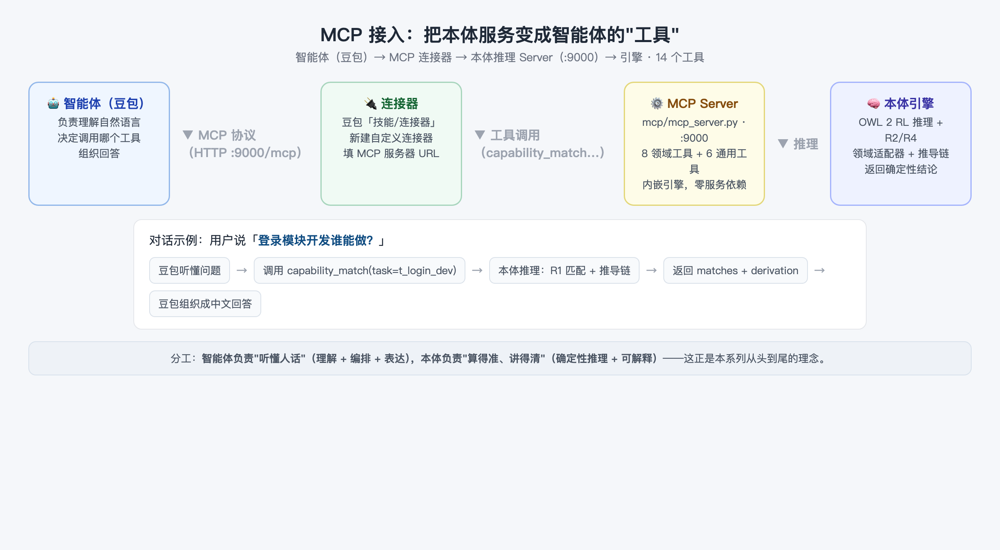

# 06 用 MCP 把本体服务接入智能体
> 本文是《本体上手指南》系列第 7 篇（共 9 篇），零基础入门「本体 × 智能体」。

> 阅读时长：约 12 分钟 · 配套动手：约 8 分钟
> **读完你能**：把本体推理服务接进豆包，让它在对话里直接调用推理工具——"智能体 × 本体"正式合体

---

## MCP 是什么

**MCP（Model Context Protocol，模型上下文协议）** 是智能体的"工具协议"。一个类比：

> 电脑想用打印机，不需要认识每一台打印机的电路，只要接上 USB 接口、装好驱动。**MCP 就是智能体的 USB 接口**：任何能力，只要按 MCP 标准封装成"工具"，智能体就能自动发现、按说明调用。

具体到本项目：推理服务把自己封成一个 **MCP Server**，向智能体（豆包）暴露一份**工具清单**——每个工具带名称、参数说明、返回值结构。智能体在对话中"看到"这些工具，就知道"哦，我可以调用 capability_match 来回答谁能做任务"。

## 第 1 步：启动 MCP Server（Docker）

```bash
cd ontology-agent-demo
docker compose up -d mcp    # 容器内启动 MCP Server（:9000）
```

启动日志（实测）：

```
[info] 本体推理 MCP Server（agent_task 领域）已启动（streamable-http）: http://127.0.0.1:9000/mcp
```

> `docker compose up` 可同时起 API(:8000) 与 MCP(:9000)；单起 MCP 用 `docker compose up -d mcp`。compose 已配置容器内绑定 `0.0.0.0`，宿主机通过端口映射访问。

- **默认传输** `streamable-http`：供豆包连接器使用，地址 `http://127.0.0.1:9000/mcp`；
- **`--transport stdio`**：供本地 MCP 客户端（如 Claude Desktop）使用——stdio 需要标准输入输出通道，适合直接在宿主机运行 `python mcp/mcp_server.py --transport stdio`（需宿主机装有依赖）；
- **`--domain`** 指定领域，默认 `agent_task`，换领域换参数即可（篇 8）；
- 端口默认 **9000**——特意避开推理 API 的 8000，两者可同时运行；
- **内嵌引擎，零服务依赖**：MCP Server 自带引擎与本体，不需要先启动 REST API。

## 第 2 步：接入豆包（连接器）

豆包电脑版侧边栏操作：

1. 侧边栏「**技能 / 连接器**」→ 右上角「**添加**」→「**新建自定义连接器**」；
2. 传输类型选 **HTTP**，MCP 服务器 URL 填 `http://127.0.0.1:9000/mcp`；
3. 保存后即可在对话中直接调用本体推理工具。

> 连接器本质：把"对话中能看到哪些工具"告诉豆包。保存后豆包就"认识"了本体的 26 个工具。

## 第 3 步：认识 26 个工具

服务共暴露 **26 个工具**，按来源分三组：**领域工具 9 个**随领域包注册（仅当领域提供 `mcp.py`；换领域这组跟着换）、**通用工具 12 个**走引擎（任意 `.owl` 可用）、**建模 / 质量工具 5 个**（TBox 草稿、SHACL 形状、CQ 质检），做"造自己的领域"（篇 8）时才会用到。

**领域工具（9 个，随领域包注册）**

| 工具 | 参数 | 说明 |
|---|---|---|
| `capability_match` | `task` | R1/R2 能力匹配：哪些智能体可执行该任务，附推导链 |
| `orchestrate` | `task` | R3 任务编排：拆解依赖链、拓扑排序、逐环节匹配执行者 |
| `assign` | `task, agent` | 任务分配 + R4 合规冲突检测 |
| `classify` | `name, capabilities, constraints, risk_level` | 新增任务个体、重推理、自动分类 |
| `consistency` | — | 全量一致性 / 合规冲突检查 |
| `explain` | — | 最近一次查询的中文推导链（回答"为什么"） |
| `ontology` | — | 本体结构导出（类/个体/边） |
| `entities` | — | 实体短名清单（任务/智能体/能力/约束 + 中文标签） |
| `status` | — | 服务与当前领域状态自检（本体、三元组数、是否就绪） |

**通用工具（12 个，走引擎，任意 .owl 可用）**

| 工具 | 参数 | 说明 |
|---|---|---|
| `query_sparql` | `sparql` | SPARQL SELECT，IRI 转短名 |
| `individuals` | `class_name` | 类（含子类）下个体列表 |
| `classes` | — | 类层次（name/label/parent） |
| `types_of` | `individual` | 个体推理后的全部类型 |
| `property_values` | `subject, property_name` | 主体-属性取值列表 |
| `infer` | — | 重新推理 + 三元组统计 |
| `explain_proof` | `subject, predicate, object` | 机读证明树（与 `explain` 的人读推导链互补） |
| `predefined_queries` | — | 列出预置的 SPARQL 查询模板 |
| `run_predefined_query` | `name` | 按名运行一条预置查询 |
| `active_facts` | — | 推理后的「激活事实」图（raw → g 的结果） |
| `guard_status` | — | 查看调用守卫（guard）状态 |
| `pipeline_gate` | `ttl, abox` | 流水线闸门状态与触发 |

有个小细节很贴心：`entities` 工具专门用来"帮智能体选参数"——它返回全部任务/智能体/能力/约束的短名与中文标签，智能体不确定参数时先查它，避免瞎猜短名。

**建模 / 质量工具（5 个，完整列表以 MCP `tools/list` 返回为准）**

| 工具 | 说明 |
|---|---|
| `guide_tbox_draft` | 引导式草拟 TBox（类 / 属性 / 公理） |
| `validate_tbox_draft` | 校验草拟 TBox 的合法性 |
| `validate_shapes` | 校验 SHACL Shapes（G4 闸门按 `@domain` 哨兵从领域包解析） |
| `guide_cq_generation` | 引导生成本体能力问题（CQ） |
| `validate_cqs` | 校验能力问题（CQ） |

## 第 4 步：对话演示完整链路

接入后，在豆包里直接问：

> **「登录模块开发谁能做？」**

完整链路（配图如下）：



1. **豆包听懂问题**：识别出这是"找任务执行者"的意图；
2. **调用工具**：`capability_match(task="t_login_dev")`；
3. **本体推理**：R1 属性链匹配，生成 `matches` 与推导链；
4. **返回结果**：研发Agent（已认证）+ 初级研发Agent（未认证）；
5. **组织回答**：豆包把 JSON 讲成人话，必要时还能追问"为什么选研发Agent"——触发 `explain` 工具。

再体验一个编排场景：

> **「新功能上线怎么安排？」**

豆包会调用 `orchestrate(task="t_feature")`，本体按 `depends_on` 传递闭包排出执行顺序（需求分析 → 开发 → 审查 → 测试 → 部署），每个环节配好执行者——这就是篇 3 讲的 R3 在真实对话里的样子。

## 与 REST API 的关系

| | REST API（:8000） | MCP Server（:9000） |
|---|---|---|
| 面向 | 前端页面、脚本、任何 HTTP 客户端 | 智能体（豆包连接器等 MCP 客户端） |
| 协议 | HTTP + JSON | MCP（JSON-RPC / SSE） |
| 工具/端点 | 29 个端点 | 26 个工具 |
| 依赖 | 独立进程 | 内嵌引擎，不依赖 REST |

两者共享**同一套引擎与领域包**——这就是篇 5（搭建本体推理服务）所讲的服务"多通道出口"：**同一种能力，按消费方选通道**。脚本和前端走 REST；智能体走 MCP。

## 小结

1. **MCP = 智能体的 USB 接口**：能力封装成标准工具，智能体自动发现、按说明调用。
2. **一行命令启动**：`docker compose up -d mcp`，内嵌引擎零依赖；豆包侧边栏加连接器即可接入。
3. **26 个工具**：9 个领域工具随领域包（仅当领域提供 `mcp.py`）+ 12 个通用工具走引擎（SPARQL、个体、类、类型、属性、重推理、证明、守卫、闸门）+ 5 个建模工具（篇 8 用到）。
4. **智能体听懂人话，本体算得准讲得清**——MCP 是两者的"合体通道"。

**常见问题**

- **Q：MCP 和 REST 到底差在哪？**
  A：REST 是"人/程序按文档调用"；MCP 是"智能体自动发现并调用"——工具带机器可读的 schema 和描述，智能体自己决定何时调用哪个。对本项目而言，二者背后是同一个引擎。
- **Q：只能接豆包吗？**
  A：不是。任何 MCP 客户端都能接：`--transport stdio` 可接本地客户端 / Claude Desktop；streamable-http 可接其他支持 MCP 的智能体平台。

---
**下一篇**：篇 7《智能体 × 本体协作实战》——总结分工模型与最佳实践，并教你判断"什么时候该用本体"。