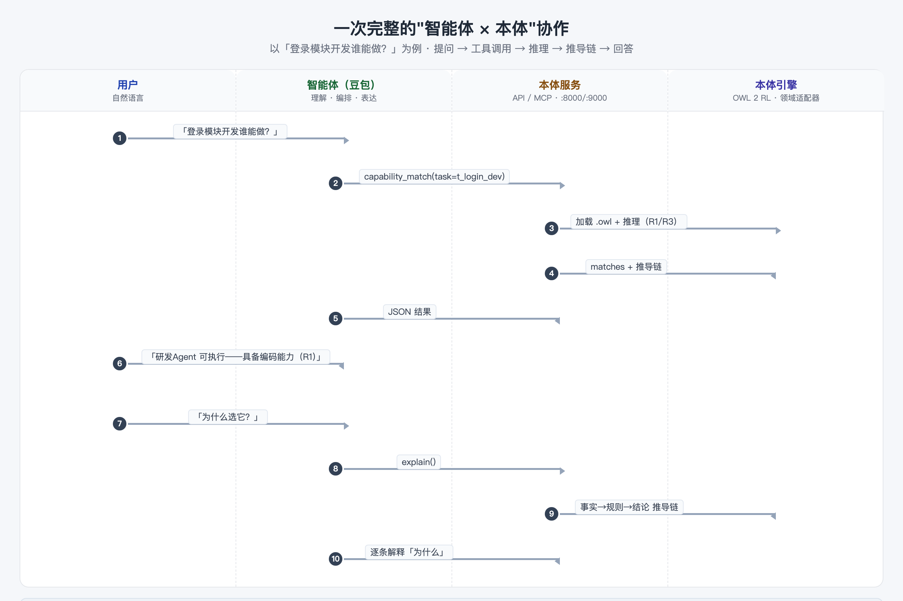

# 07 智能体 × 本体协作实战

> 阅读时长：约 12 分钟 · 配套动手：约 5 分钟
> **读完你能**：设计自己的"智能体 + 本体"应用——知道二者怎么分工、什么时候该用本体、有哪些坑要避开

---

## 分工模型：谁干什么

六篇下来，协作模式其实只有一句话：

> **智能体负责"听懂人话"（理解 + 编排 + 表达），本体负责"算得准、讲得清"（确定性推理 + 可解释结论）。**

| | 智能体（豆包等） | 本体（推理服务） |
|---|---|---|
| 擅长 | 自然语言理解、意图识别、组织回答 | 规则推理、确定性结论、推导链解释 |
| 不擅长 | 每次都给出**确定且唯一**的答案 | 理解"换个说法"的同义问题 |
| 产出 | 对话、文案、编排动作 | JSON 结论 + 事实→规则→结论 |

两者都不"全能"，但组合起来正好互补——这就是本系列想传递的核心架构模式。

## 一次完整协作：10 步走完



以「登录模块开发谁能做？」为例，完整链路是：

1. 用户用自然语言提问；
2. 智能体识别意图，调用 `capability_match(task=t_login_dev)`；
3. 本体服务加载 .owl、执行 OWL 2 RL 推理（R1 属性链 / R3 传递）；
4. 引擎返回 `matches`（候选智能体）+ 推导链；
5. 服务把结果回传给智能体；
6. 智能体组织成人话回答；
7. 用户追问"为什么选它？"；
8. 智能体调用 `explain()`；
9. 服务返回推导链（事实 → 规则 → 结论）；
10. 智能体逐条讲给用户听。

注意第 7–10 步：**"为什么"也是本体回答的，不是智能体编的**。这正是确定性应用最值钱的地方——可审计。

## 什么时候用本体、什么时候靠大模型

判断清单（按顺序问自己，任一命中"是"就优先考虑本体）：

| 问题 | 是 → | 否 → |
|---|---|---|
| 答案必须**确定且唯一**（同输入同输出）？ | 本体 | 大模型 |
| 结论需要**可解释、可审计**（能回答"为什么"）？ | 本体 | 大模型 |
| 知识要**跨系统共享沉淀**（换应用不重说）？ | 本体 | — |
| 关系规则**相对稳定**、可以建模？ | 本体 | 图数据库/文档 |
| 是开放创作（文案、总结、头脑风暴）？ | — | 大模型 |

三个典型"该用本体"的业务场景：

- **任务/资源分配**：谁能做、分给谁、合不合规——必须确定、可解释；
- **权限与合规判定**：某操作是否被允许——错了会出事，必须可审计；
- **流程编排**：先做什么后做什么——依赖关系固定，推理自动排序。

而"帮我写一段宣传语""总结这份文档"这类开放任务，交给大模型就好——**不要拿本体做创作，也不要拿大模型做判定**。

## 六种查询模式回顾

整个系列的查询，归纳起来就是六种模式——它们构成了"智能体 × 本体"应用的最小工具箱：

| 模式 | 问题示例 | 工具/端点 | 规则 |
|---|---|---|---|
| **匹配** | 谁能做这件事？ | `capability_match` | R1/R2 属性链 |
| **编排** | 这件事怎么安排？ | `orchestrate` | R3 依赖拓扑 |
| **分配** | 把 X 分配给 Y | `assign` | R4 合规检测 |
| **分类** | 新增的任务属于哪类？ | `classify` | 推理 + 分类规则 |
| **一致性** | 现在有没有冲突？ | `consistency` | 全量扫描 |
| **解释** | 为什么选它？ | `explain` | 推导链 |

设计自己的应用时，先想清楚"用户会问哪几类问题"，再映射到这六种模式——基本就能覆盖大部分需求。

## 最佳实践与坑（全部实测）

**1. 分配会实时改图谱（但要认清"改在哪里"）**

执行分配后，`graph_export` 会立刻出现 `assigned_to` 边。实测：

```python
adapter.assign(adapter.NS["t_login_dev"], adapter.NS["dev_agent"])
# graph_export 中 assigned_to 边: 1  →  t_login_dev --assigned_to--> dev_agent
```

**坑**：分配记录存在适配器的"分配表"里（运行时状态），不是写进 .owl 文件。**重启服务后分配会消失**——需要持久化的场景要自己接存储。

**2. 新增个体后必须重推理**

`classify` 实测（新增任务 t_chat_task，需要"编码实现"、带合规约束、风险 5）：

```json
inferred_types: ["ComplianceTask", "HighRiskTask"]
// 推理后：dev_agent、junior_dev 均可执行该任务（R1 自动算出）
```

**坑**：新增/修改个体后，如果不触发 `reparse()`（重推理），新个体不会参与分类和能力匹配——**改图必重推**，这是最容易踩的顺序坑。

**3. 领域包"坏包"快速失败**

config.json / derivation.json 缺失时，服务直接抛异常，不做静默兜底。这是设计上的故意行为：**领域包数据缺失是错误状态，早暴露比晚暴露好**。换领域时先跑 `pytest` 验证。

**4. 一致性检查是兜底防线**

分配可以单独执行，也可能绕过检查——`consistency` 就是事后全量扫描：遍历所有分配，输出冲突清单与"高风险任务无人可执行"提示。**上线前/定期跑一遍，比每次拦截更省心**。

**5. 短名与中文名双轨，别让智能体猜参数**

工具参数接受短名（`t_login_dev`），智能体不一定记得住——`entities` 工具专门返回全部短名 + 中文标签。**给智能体的工具描述写得越具体，调用越准**（见篇 6 工具表）。

## 扩展预告

到此，"智能体 × 本体"的最小闭环你已经完整走通了。如果想更进一步——**把这份能力变成你自己的**（换业务本体、新建领域、加规则），篇 8 是最后一块拼图。

## 小结

1. **分工**：智能体听懂人话，本体算得准讲得清——这是贯穿全系列的架构模式。
2. **判断**：答案要确定/可解释/可共享 → 用本体；开放创作 → 用大模型。
3. **六种查询模式**是设计"智能体+本体"应用的最小工具箱。
4. **四个坑**：分配是运行时状态（重启消失）、改图必重推、坏包快速失败、给智能体配好 `entities`。

**常见问题**

- **Q：智能体调用错工具怎么办？**
  A：MCP 工具的描述就是"说明书"。描述越具体（含参数示例、短名提示），智能体选得越准；`entities` 让它在不确定时先查参数。
- **Q：本体的规则谁来维护？**
  A：规则分两层：建模层（.owl 公理，本体工程师/领域专家用 Protege 维护）与业务层（config.json/derivation.json，**改配置即改行为，不用动代码**——篇 8 演示）。

---
**下一篇**：篇 8《把本体服务变成你自己的》——换本体、新建领域、加规则，从"会用"到"能造"。
