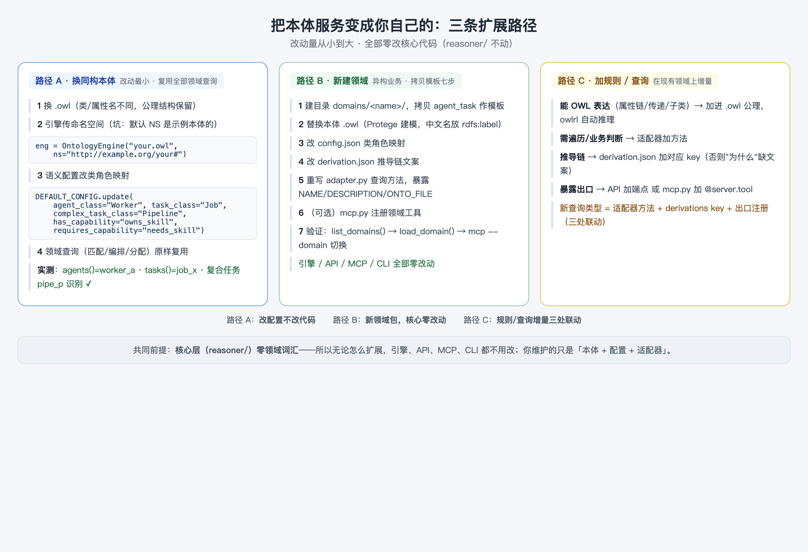

# 08 把本体服务变成你自己的

> 阅读时长：约 12 分钟 · 配套动手：约 15 分钟
> **读完你能**：换掉示例本体、新建自己的领域、加自己的规则与查询——从"会用"到"能造"

---

## 三条扩展路径

前 7 篇你都在"用"示例本体（智能体任务编排）。这一篇讲"造"：把这套能力变成你自己的。按改动量从小到大，有三条路径：



| 路径 | 场景 | 改动量 |
|---|---|---|
| **A 换同构本体** | 业务结构相似，只是类名/属性名不同 | 最小：改配置，不改代码 |
| **B 新建领域** | 完全不同的业务 | 中：拷贝模板，核心零改动 |
| **C 加规则/查询** | 在现有领域上增量扩展 | 小-中：三处联动 |

**共同前提**：核心层（reasoner/）零领域词汇——所以无论怎么扩展，引擎、API、MCP、CLI 都不用改。

## 路径 A：换一个同构本体（实测）

假设你的业务叫"工人-工作"：类叫 Worker/Job/Pipeline，属性叫 owns_skill/needs_skill，但结构（谁有技能、任务要什么技能、复合任务由子任务组成）和示例本体一模一样。

只需要两步配置（全部实测验证）：

```python
from reasoner.engine import OntologyEngine
from domains.agent_task import AgentTaskAdapter, DEFAULT_CONFIG

# 1. 加载新本体，必须传命名空间！
eng = OntologyEngine("your_ontology.owl", ns="http://demo.example.org/worker-job#")

# 2. 覆盖类角色映射，领域查询原样复用
adapter = AgentTaskAdapter(eng, DEFAULT_CONFIG.update(
    agent_class="Worker", task_class="Job", complex_task_class="Pipeline",
    has_capability="owns_skill", requires_capability="needs_skill"))
```

实测结果（最小同构本体）：

```text
agents(): ['worker_a']              # Worker 类的个体
tasks():  ['job_x']                 # Job 类的个体
复合任务识别 pipe_p: True           # Pipeline 类被识别为复合任务
classify 新个体 job_y: 正常分类      # 新增/分类能力照常工作
```

**两个关键点（都是实测踩出来的）**：

1. **必须传 `ns` 参数**。引擎的默认命名空间是示例本体的（`agent-task-ontology#`），不传的话，`Worker` 会被解析成示例本体的命名空间下，查不到任何个体——表现为 `agents()` 静默返回空。**换本体第一件事：确认命名空间并传入**。
2. **公理结构必须保留**。R1 属性链（`has_capability ◦ required_by ⊑ can_execute`）、R3 传递闭包这些推理规则活在**本体公理**里。新本体只要保留同样的公理结构，推理自动复用；业务规则 R2/R4 在适配器代码里，与本体解耦，天然不受影响。

## 路径 B：新建一个领域（七步）

业务异构时（比如从"任务编排"换到"供应链风险"），新建领域包。按 DESIGN.md 的约定，**新增一个领域 = 在 `domains/` 下新建一个自包含目录，暴露约定符号，引擎/API/MCP/CLI 全部复用，零改动**：

```
domains/<name>/
├── __init__.py            # 纯导出：转发 adapter / mcp 的符号
├── adapter.py             # 业务逻辑（必暴露 NAME/DESCRIPTION/ONTO_FILE/create_adapter）
├── config.json            # 领域语义配置（类角色映射）
├── derivation.json        # 推导链配置（文案 + 展开规则）
├── mcp.py                 # 领域 MCP 工具注册（可选，有则自动加载）
└── <name>_ontology.owl    # 本体定义（Protege 可编辑）
```

七步流程：

1. 建目录 `domains/<name>/`，**拷贝 `agent_task` 作模板**；
2. 替换本体 `.owl`（用 Protege 建模，**中文名统一放 `rdfs:label`**——它是中文名的唯一事实源）；
3. 改 `config.json` 的类角色映射与结构数据；
4. 改 `derivation.json` 的文案与展开规则；
5. 重写 `adapter.py` 的查询方法（引擎原语 + 你的业务规则），暴露 `NAME/DESCRIPTION/ONTO_FILE`；
6. （可选）写 `mcp.py` 注册该领域的 MCP 工具（供智能体调用）；
7. 验证：`list_domains()` 出现新领域 → `load_domain("name", engine)` 能加载 → `mcp/mcp_server.py --domain name` 自动切换领域工具。

注意第 3–4 步和 `adapter.py` 的职责分工：**配置管"语义映射"，代码管"业务逻辑"**。绝大多数"换个说法"（类名、属性名、展示文案）动配置即可。

## 路径 C：加规则与查询类型

在现有领域上增量扩展，两条分支：

**加一条推理规则**

| 规则性质 | 做法 |
|---|---|
| OWL 能表达（属性链/传递/子类） | 加进本体公理，owlrl 自动推理，**零代码** |
| 需要遍历/业务判断（如 R2 复合委派、R4 合规冲突） | 在适配器加方法，并在 `derivation.json` 的 `derivations` 增加对应 key（否则"为什么"缺文案） |

**加一个查询类型**（三处联动）

1. 适配器加方法（返回 dict，可附 `derivation` 推导链）；
2. `derivation.json` 加对应 key（`expand` 按 key 查找展开文案）；
3. 出口注册：API 层加端点，或领域 `mcp.py` 的 `register_tools` 里加 `@server.tool`。

## 一条原则贯穿始终

> **本体管"是什么、能推出什么"，适配器管"业务怎么问"，配置管"说法怎么变"。三者分离，扩展才不用动核心。**

- **本体是唯一事实源**：类/个体/属性/中文名都在 .owl 里，配置不重复维护；
- **配置即行为**：改 `DEFAULT_CONFIG.update(...)` 就换了语义绑定，代码不动；
- **领域包自包含**：一个目录装下一个业务的全部，可插拔、可拷贝、可分享。

## 系列小结：9 篇路线图

到此，9 篇正文全部完成。回头看这条学习路径：

| 阶段 | 篇目 | 你学会了 |
|---|---|---|
| **概念** | 0 为什么需要本体 / 1 本体入门 / 2 解剖示例本体 | 本体是什么、解决什么、长什么样 |
| **推理与图谱** | 3 推理原理 / 4 本体与知识图谱 | 推理怎么发生、和知识图谱的关系 |
| **服务** | 5 搭建推理服务 / 6 MCP 接入智能体 | 本体如何变成可调用的服务 |
| **应用** | 7 协作实战 / 8 扩展新领域 | 智能体怎么用、你如何造自己的 |

贯穿始终的是同一个示例（智能体任务编排本体）和三个场景（登录模块开发、新功能上线、合规报表分配）。建议按顺序把每篇的"动手"做一遍——全部命令在项目根目录可复现，配图源文件在 `docs/guide/assets/` 下可改。

## 常见问题

- **Q：换本体后推理规则还能用吗？**
  A：公理结构保留即可——R1 属性链、R3 传递闭包活在公理里，随本体一起换；R2/R4 业务规则在适配器代码里，与本体解耦。所以"同构本体"意味着两者都不用动。
- **Q：不想用 Python 技术栈怎么办？**
  A：本体本身是标准 RDF/OWL 文件，任何支持 OWL 的工具链（Protege、owlready2、任意图数据库）都能消费；本项目只是提供了一套开箱即用的服务层。架构思路（核心零领域词汇 + 领域包可插拔）与语言无关。

---
**全系列完**。想看完整的系列地图和学习路径，见 `docs/guide/README.md`（系列索引）。
