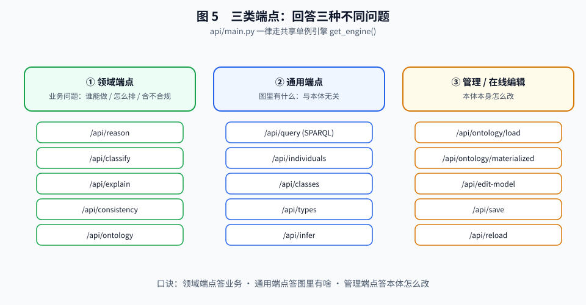

# 搭建本体推理服务（操作手册）

> 本文从《本体上手指南》**第 05 篇《本体、推理与解释》**拆分而来，聚焦"把推理服务跑起来"的实操步骤。
> 概念、权衡与实现机制请回到 [指南 05](../../guide/05-搭建本体推理服务.md)；本手册只讲"动手"。

概念、权衡、机制都立住了，最后才是跑起来。

### 第 1 步：环境准备（Docker）

无需在宿主机装任何 Python 依赖——容器镜像已内置全部依赖（rdflib / owlrl / fastapi / uvicorn / mcp）：

```bash
cd ontology-agent-demo
docker compose up -d api     # 首次自动构建镜像（稍等片刻），之后秒级启动
```

### 第 2 步：启动与验证

```bash
curl -s http://127.0.0.1:8000/api/health
```

```json
{"status":"ok","ontology":"agent_task_ontology.owl",
 "reasoner":"OWL 2 RL (owlrl) + 业务规则 R2/R4",
 "domain":"agent_task","agents":5,"tasks":8,"assignments":0}
```

一眼看清：加载的本体、推理器、当前领域、Agent/Task 数量。

### 第 3 步：端点一览（分三族）

| 族 | 走哪层 | 回答什么问题 |
|---|---|---|
| **① 领域端点** | 适配器（绑定语义） | 业务问题：谁能做 / 怎么排 / 合不合规 / 怎么建实体（`/api/reason`、`/api/entities`、`/api/entities/schema`、`/api/explain`、`/api/consistency`、`/api/ontology`） |
| **② 通用端点** | 引擎（与本体无关） | 图里有什么：`/api/query`(SPARQL)、`/api/individuals`、`/api/classes`、`/api/types`、`/api/property`、`/api/infer` |
| **③ 管理 / 在线编辑** | 通用层扩展 | 本体本身怎么改：`/api/ontology/load`、`/materialized`、`/edit-model`、`/save`、`/reload`、`/export` 等 |

> 口诀：**领域端点答"业务问题"、通用端点答"图里有什么"、管理端点答"本体本身怎么改"**（③ 正是"在线编辑改版"落点）。



### 第 4 步：curl 实操 3 例（带机制注解）

**例 1：能力匹配（业务问题 + 解释）**

```bash
curl -s -X POST http://127.0.0.1:8000/api/reason \
  -H "Content-Type: application/json" \
  -d '{"type":"capability_match","task":"t_login_dev"}'
```

```json
{"task":"t_login_dev","task_label":"登录模块开发","task_type":"简单任务",
 "matches":[
   {"agent":"dev_agent","agent_label":"研发Agent","certified":true,"rule":"R1"},
   {"agent":"junior_dev","agent_label":"初级研发Agent","certified":false,"rule":"R1"}
 ],
 "derivation":[
   {"kind":"section","content":"候选 1：研发Agent"},
   {"kind":"fact","content":"Agent「研发Agent」具备能力「编码实现」（has_capability）"},
   {"kind":"rule","content":"规则 R1（OWL 属性链）：has_capability ◦ required_by ⊑ can_execute"},
   {"kind":"conclusion","content":"结论：研发Agent 可执行「登录模块开发」"}
 ]}
```

> 机制注解：返回里的 `rule:"R1"` 和 `derivation`，就是指南 05 §3.2 那条被物化的 `can_execute` 边 + §3.4 声明式解释器生成的步骤。`certified` 来自 `has_certified` 数据属性，`rule` 由 `_rule_for()` 判定。

**SPARQL 前置小课堂**：通用端点 `/api/query` 接受标准 **SPARQL**（W3C 图查询语言）。最常用形式是 `SELECT ?变量 WHERE { 三元组模式 }`：大括号里写"你想匹配的模式"，`?i` 是占位变量，引擎在推理图 `g` 上找出所有能套进该模式的三元组、把 `?i` 的取值返回给你。下面 `?i a <Agent>` 意为"找出所有类型是 Agent 的个体"。

**例 2：SPARQL 图查询（通用问题）**

```bash
curl -s -X POST http://127.0.0.1:8000/api/query \
  -H "Content-Type: application/json" \
  -d '{"sparql":"SELECT ?i WHERE { ?i a <http://demo.example.org/agent-task-ontology#Agent> }"}'
```

```json
{"results":[{"i":"junior_dev"},{"i":"dev_agent"},{"i":"deploy_agent"},{"i":"req_agent"},{"i":"test_agent"}]}
```

> 机制注解：通用端点是"直连接口"，在**已推理的图 `g`** 上跑（`query_sparql`）。查 `a Agent` 能列出 5 个，正因 OWL 2 RL 把 `SimpleAgent`/`CertifiedAgent` 等子类个体也闭包进了 `Agent` 类型（指南 05 §1.2）。

**例 3：物化 diff（看推理加了什么）**

```bash
curl -s http://127.0.0.1:8000/api/ontology/materialized | head -c 400
```

> 机制注解：返回 `asserted`（你写的）与 `inferred`（推出来的）两张子图——这就是指南 05 §3.6 的物化 diff，也是"在线编辑"敢让你改本体的底气。

### 第 5 步：CLI 双通道

同源封装了 CLI `scripts/query.py`（已打进容器），**双通道**：默认走 HTTP API，服务没启动自动回退内嵌引擎（`--local` 强制内嵌，`--http` 强制 HTTP）：

```bash
docker compose exec api python scripts/query.py capability_match --task t_login_dev --pretty
docker compose exec api python scripts/query.py orchestrate --task t_feature --pretty
docker compose exec api python scripts/query.py consistency --pretty
```

### 第 6 步：验证

```bash
docker compose exec api python -m pytest tests/ -q
```

项目测试套件 **178 个测试**（覆盖 R1–R4 推理、推导链结构、全部 API 行为），跑通说明环境与代码健康。

### 第 7 步：边界情况与排查（Debug）

**边界情况演示**（均为正常行为，不是 bug）：
- **无人可执行的任务**：`capability_match` 返回 `"matches": []`——这是"空集"结论，前端应提示"无匹配智能体"，而非报错。
- **本体文件缺失 / 挂载路径错**：`docker compose up` 阶段即抛 `FileNotFoundError`；核对 `docker-compose.yml` 中本体挂载路径。
- **推理结果为空但预期有**：最常见是属性链方向写反（如只写了 `requires_capability` 却忘了声明它与 `required_by` 的逆属性），导致链接不上。

**常见报错 → 定位 → 解法**：

| 现象 | 可能原因 | 解法 |
|---|---|---|
| `ModuleNotFoundError: owlrl` | 依赖未装 | `pip install rdflib owlrl`，或重新 `docker compose build` |
| 查询返回空、但确信有数据 | 查的是 `g` 而非 `raw`；或子类闭包未生效 | 确认端点走推理图 `g`；检查 `rdf:type` 子类声明 |
| `can_execute` 查不到复合任务 | R2 未触发（非 `ComplexTask` / 子任务不全可执） | 核对 `composed_of` 与 `is_complex_task` |
| 改完本体关系"没变" | 未触发重建 | 调用 `/api/ontology/reload` 或重启容器 |
| SPARQL 报语法错误 | 查询语言拼错 / 类 IRI 不对 | 先用 `/api/individuals` 确认类 IRI，再写 `WHERE` |

---

← 返回：[指南 05《本体、推理与解释》](../../guide/05-搭建本体推理服务.md)
